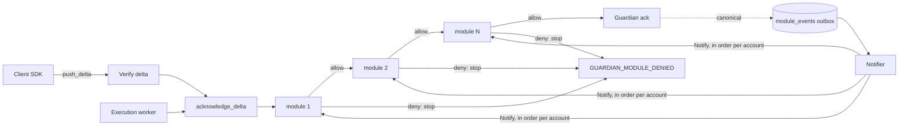

# RFC 0002: Guardian modules, a hook pipeline for pluggable policy

| | |
|---|---|
| **Status** | Open for comment |
| **Depends on** | [RFC 0001](https://github.com/OpenZeppelin/guardian/blob/254-execution-impl/docs/rfcs/0001-server-side-transaction-execution.md) (server-side transaction execution, on PR #510 until it merges): the execution worker is the second caller of the pipeline |
| **Feature** | [#251](https://github.com/OpenZeppelin/guardian/issues/251) ("Modularization: middleware architecture and pluggable modules"); first consumer [#182](https://github.com/OpenZeppelin/guardian/issues/182) (policy evaluation). [#252](https://github.com/OpenZeppelin/guardian/issues/252) (x402 facilitator) is a later consumer: its payment-policy half (caps, allowlists, replay) fits `before_transaction_approved` and `after_transaction_committed`, its facilitator half (`/verify`, `/settle`, a flow that starts and waits) does not fit allow/deny and is future work (section 7) |
| **Audience** | Operators, module authors, integrators, and anyone reviewing the Guardian trust model |
| **Working artifacts** | [`speckit/features/251-guardian-modules/`](../../speckit/features/251-guardian-modules/spec.md): the specification, written alongside this RFC; plan and tasks follow the prototype |
| **Revision** | 23 (2026-10-19): resync ordering (sections 3.3, 3.4, 4.2), found by a TLA+ model of the notify and `pending` design: a resync keeps the (module, account) pair refused until the module has acknowledged `NotifyGap`, and failed Gap calls are retried rather than skipped; the Gap obligation is stored with the delivery cursor, and no replica sends an event while it is open, because a replica that has lost the lease could otherwise deliver an event committed after the resync ahead of the Gap and the module would skip its reset; `resume_from_nonce` defined from the last skipped event; the false claim that a stale leader only has pre-resync events in flight corrected (Appendix B); `Retained` and client-abandoned rows stated to be outside `pending`, with the argument that a limit still holds; model-checked claims tagged **[RAN]**; resync conformance cases |
| **Earlier revisions** | Appendix C |
| **Code baseline** | `main` at `1224ef13`; execution-path citations read on `254-execution-impl` at `29c722b4` (PR #510). Miden pins: protocol 0.17.0. Prototype findings (2026-10-13 to 2026-10-15) in `speckit/features/251-guardian-modules/research.md` |

---

## Executive summary

Today every rule about whether the Guardian co-signs a transaction is compiled into the server: signature checks, candidate-chain rules, the account pause flag. Operators who need compliance screening, spending caps or risk scoring have nowhere to put that logic.

**After this work**, the Guardian runs a **hook pipeline** at fixed points in its lifecycle. At each hook it calls an ordered list of **modules**, and each module answers allow or deny. Every module is an instance of a **module kind**: either a remote kind (`grpc` first, `http` later) that calls a service the operator deploys, or an in-process kind compiled into the Guardian. First-party kinds ship in the official image; operators can register their own kinds from a crate through `ServerBuilder` and run their own build (section 2.5). Modules are declared in server configuration, assigned to accounts by operators, and opt-in: a Guardian with no modules configured behaves exactly as it does today.



**What stays the same:**

- **A remote module can only withhold a Guardian signature, never produce one.** With any set of remote modules, the Guardian signs a subset of what it would sign without them. A compromised remote module can deny service; it cannot authorize anything. In-process kinds are trusted code with the Guardian's full privileges (section 5.1).
- **Users can always leave.** `SwitchGuardian` executes on chain without a Guardian acknowledgement, so no module can block an account from switching away (section 2.3, Appendix B).
- **No modules, no cost.** An account with an empty module set skips the pipeline entirely.

**Modules do not replace on-chain policy.** A rule enforced in the account's own MASM code holds even if the Guardian is compromised or bypassed; a module only decides whether one co-signer signs. Modules exist for rules that need off-chain data, such as sanctions lists, risk scores or a vendor's records, and for rules an operator must change without an account upgrade. A limit that can be expressed on chain is stronger there, and both can apply to one account (section 8).

---

## 1. Requirements

Collected from #251, its linked issues and the policy discussion on #238.

| # | Requirement | Source | Status |
|---|---|---|---|
| R1 | Transactions pass through an ordered pipeline of modules before the Guardian signs; each returns success or failure | #251 | Covered |
| R2 | Hooks at least before transaction approval and before account registration; the hook set is designed, not ad hoc | #251 | Covered |
| R3 | Modules are external, pluggable, registered by URL, independently deployable; the core stays lean and modules are opt-in | #251 | Covered (`grpc` kind; `http` after M2, section 7) |
| R4 | A Guardian may register several modules; each account has its own module selection and configuration | #251 comment 2026-08-12 | Covered |
| R5 | When the Guardian runs in a TEE, modules may need to run in the same trusted environment with defined access to private state; the RFC defines configuration, execution, isolation and trust for both cases | #251 comment 2026-08-12, #69 | Partly: design only (section 6); attestation fields in the catalog deferred to #69 |
| R6 | Policies evaluate the decoded transaction, never the proposer-asserted `proposal_type` | #238 (Q3) | Covered |
| R7 | Transaction-type filtering belongs in a module, not a core allowlist | #266 | Covered |
| R8 | Stateful policies (daily volume, velocity, cooldowns) must be implementable | #238 policy list | Covered in candidate mode (section 3.4) |

---

## 2. Design

### 2.1 Module kinds and instances

Two concepts are kept apart:

- A **module kind** is code: an implementation of the `Module` trait, registered under a kind name when the server is built.
- A **module instance** is configuration: a catalog entry (section 2.2) that names a kind and supplies its settings and parameters. One kind can back several instances, for example the same sanctions kind configured once per list.

```rust
#[async_trait]
pub trait Module: Send + Sync {
    async fn describe(&self, guardian: &DescribeRequest) -> Result<ModuleInfo, ModuleError>;
    async fn validate_params(&self, params: &[u8]) -> Result<ParamsVerdict, ModuleError>;
    async fn evaluate(&self, request: &HookRequest) -> Result<Decision, ModuleError>;
    async fn notify(&self, event: &CommitEvent) -> Result<(), ModuleError> {
        Ok(())
    }
    async fn notify_gap(&self, gap: &Gap) -> Result<(), ModuleError> {
        Ok(())
    }
}

pub trait ModuleFactory: Send + Sync {
    fn create(&self, instance: &ModuleInstanceConfig) -> Result<Arc<dyn Module>, ModuleError>;
}
```

**Instance identity.** Every message the Guardian sends to a module carries `instance_id`, the catalog `id` of the instance it is calling (`ValidateParamsRequest`, `HookRequest`, `CommitEvent`, `Gap`). One remote service can therefore back several instances, for example a sanctions service configured once per list, and keep their state, delivery watermarks and resync handling apart: a module keys all state by (`instance_id`, `account_id`). Each instance has its own `auth` credential, and the `serve` harness binds credentials to instance ids (`.instance("sanctions-ofac", token_file)`), rejecting with `PERMISSION_DENIED` a request whose `instance_id` does not match the credential that authenticated it. An operator who prefers full isolation can still give each instance its own endpoint; the protocol does not depend on it.

The trait, the factory and all protocol types live in a separately published crate, `guardian-module-sdk`, so a kind can be written without depending on the server (section 2.5). `notify` and `notify_gap` have default no-ops, so a stateless kind implements only `describe`, `validate_params` and `evaluate`; stateful kinds override it to reset or re-seed state after a gap (section 3.3). Besides the trait, the SDK provides what the prototype showed every module needs: `Decision::allow` and `Decision::deny`, `ParamsVerdict::ok` and `ParamsVerdict::invalid`, reason-code validation, typed accessors over the generated messages (for example the fungible amount of an `Asset`), and `ModuleInstanceConfig`, the configuration a factory receives, whose bearer token is a secret type, redacted from debug output and zeroized when dropped. The `GrpcModule` implementation (and `HttpModule`, when that kind ships) calls the `NotifyGap` RPC, and the `serve` harness routes `NotifyGap` to `notify_gap`, so in-process and remote modules see gaps the same way.

First-party kinds, registered by the official binary (through `ServerBuilder::from_env()` once M2c ships, section 7) and present in the official image:

| Kind | Runs | Settings | Notes |
|---|---|---|---|
| `grpc` | Remote | `endpoint = "grpc://host:port"` (TLS), `auth` | Calls a service implementing `guardian.module.v1.GuardianModule` |
| `http` | Remote | `endpoint = "https://host[:port]"`, `auth` | Not in M2; added if operators ask for it (section 7). Same messages in the proto3 JSON mapping at `GET /v1/describe`, `POST /v1/validate-params`, `POST /v1/evaluate`, `POST /v1/notify`, `POST /v1/notify-gap`. HTTP 404 or 501 from `/v1/notify-gap` is treated like gRPC `UNIMPLEMENTED` (section 3.3) |
| `basic-policy` | In process | none | Reference policy: recipient allowlist and denylist, asset allowlist, per-transaction amount cap, signer allowlist and denylist. Stateless: supports `before_transaction_approved`, `before_proposal_created` and `before_account_registered` (section 2.3) |

Operator-registered kinds run in process (section 2.5). The proto file is the single source of truth for both remote kinds, so there is one schema to version. A conformance suite in `guardian-module-sdk` runs the same cases against in-process and gRPC modules (and HTTP modules once that kind ships) and asserts identical decisions. Deferring `http` keeps the first suite free of the proto3 JSON mapping rules (base64 `bytes`, decimal-string `int64`, RFC 3339 timestamps); `grpc://` endpoints already meet R3's "registered by URL".

`evaluate` must be free of side effects: clients retry `push_delta`, the same transaction can be evaluated at `before_proposal_created` and again at `before_transaction_approved`, and an evaluation is not a commitment. State a module keeps (volume counters, recipient first-seen times) is updated from `notify`, which reports only what actually became canonical. Transactions the Guardian has signed but the module has not yet acknowledged through `notify` arrive with every `evaluate` request in `pending` (section 3.4), so a stateful module decides on its counters plus `pending` plus the transaction at hand, and never counts anything in `evaluate`.

### 2.2 Registration, assignment and order

**The module catalog is server configuration**: a TOML file whose path is given by `GUARDIAN_MODULES_CONFIG`, loaded at startup and documented in `docs/CONFIGURATION.md`. Like every other Guardian setting, a change to the file applies on restart or rolling deploy; the file is not reloaded at runtime (section 2.2, runtime changes). Adding a module that can veto signing is an infrastructure change and gets deploy-level review; an operator dashboard session cannot point the approval path at a new URL.

For most operators, using modules is therefore configuration only: the official image ships first-party kinds, the operator declares instances of them (or of `grpc` for remote modules) in the catalog file, and day-to-day per-account changes go through the operator API. No build step is involved.

Each catalog entry:

| Field | Meaning |
|---|---|
| `id` | Stable instance identifier, used in errors, metrics and the operator API |
| `kind` | Registered module kind (section 2.1). An unregistered kind stops startup for an enabled instance; a disabled one is logged and stays disabled |
| `endpoint` | Remote kinds only: `grpc://…`, always TLS (`https://…` for `http` once it ships). Plain text needs the explicit `grpc+insecure://…` scheme and a loopback host, and is refused in the prod stage (section 5.2) |
| `scope` | `all`, `default` or `assigned` (see scopes below) |
| `hooks` | Subset of the hooks in section 2.3 |
| `timeout_ms` | Required; at most `GUARDIAN_MODULE_TIMEOUT_MAX_MS` (default 1000) |
| `on_error` | `deny` (default) or `allow` (section 4) |
| `auth` | Remote kinds only, mandatory in the prod stage: secret reference for the bearer token (section 5.2) |
| `tls` | Remote kinds only, optional: `ca_file` (PEM bundle for a private CA; the system roots otherwise) and `client_cert` and `client_key` secret references for mTLS (section 5.2) |
| `params` | Initial global parameters as a JSON object, written to the metadata store the first time the instance id is seen and managed through the operator API afterwards (see layered parameters below) (TOML tables in the catalog are converted to JSON). Modules receive params as UTF-8 JSON bytes in RFC 8785 canonical form (JCS). The decoded bytes are identical on every transport: in process and over gRPC they arrive as raw bytes, while over `http` (once it ships) the proto3 JSON mapping carries them as a base64 string that decodes to the same bytes (likewise `int64` fields arrive as decimal strings and `Timestamp` fields as RFC 3339 strings, per the standard mapping). See "Parameters and secrets" below |
| `require_fresh_state_ms` | Optional maximum notify lag in milliseconds (section 3.3) |
| `enabled` | Default `true`. A one-time seed, read only the first time an instance id is seen; afterwards the runtime flag in the metadata store governs and later edits of this field have no effect (see runtime changes below) |
| `disclosure`, `description`, `client_reason`, `dry_run` | What the account's cosigners may learn about the instance: the policy summary, generic or full denials, and the dry-run check (section 2.7). Defaults disclose nothing beyond today's denials |
| `operator_can_disable` | Default `false`. When `true`, the operator API may disable this instance at runtime. Enabling is always allowed (see runtime changes below) |

```toml
[[module]]
id = "spend-cap"
kind = "basic-policy"
scope = "default"
hooks = ["before_transaction_approved"]
timeout_ms = 50
on_error = "deny"
params = { max_amount_per_tx = { "0x5e0f...c3" = "1000000" } }

[[module]]
id = "risk-vendor"
kind = "grpc"
endpoint = "grpc://risk:7443"
scope = "assigned"
hooks = ["before_transaction_approved", "after_transaction_committed"]
timeout_ms = 300
on_error = "allow"
auth = { token_secret = "guardian/modules/risk-vendor-token" }
```

**Parameters and secrets.** Params are a JSON object. A value of the form `{"$secret": "<name>"}` is a secret reference, resolved by the Guardian through its secrets backend. `$secret` is a reserved key at any depth: the Guardian scans params recursively, so a reference nested inside another object is found and treated exactly like a top-level one, and no module param may use `$secret` as an ordinary key. Secret references are allowed only in catalog entries of in-process kinds, and are resolved when the instance is created. They are rejected in catalog entries of remote kinds (a remote module holds its own credentials) and in per-account params written through the operator API (otherwise a session could read arbitrary secrets through a module). Resolved secret values are never placed in a `HookRequest`, so they never reach a remote module. An in-process instance whose catalog params contain references receives, in its own `HookRequest.params`, the unresolved form with the references intact; it holds the resolved values from its factory, which received them when the instance was created. The `serve` harness and the conformance suite follow the same rule and never substitute.

The catalog is loaded in `ServerBuilder::build()`, after every `with_module_kind` call, so custom kinds are registered before any instance names them. `build()` creates every instance through its kind's factory, calls `describe` on it and checks that it supports the hooks it is configured for and speaks a supported `protocol_version`, then calls `validate_params` on the instance's stored global params (the catalog's `params` on first start), in the same unresolved form the module later receives in `HookRequest.params` (secret references intact), so a mistyped value in the catalog fails at startup rather than on the first transaction. In the prod stage a mismatch or an unreachable enabled module stops startup, mirroring `reject_filesystem_in_prod`; a disabled instance that fails these checks is logged and stays disabled, and enabling it runs the same checks first. Failing to create the instance at all, because its kind is not registered or its factory rejects the configuration (for example a malformed endpoint), is one of these failures: it stops startup for an enabled instance and leaves a disabled one disabled, so an operator can stage an instance for a module or a build that is not deployed yet.

**Scopes** decide which accounts a module applies to without the operator visiting every account:

| Scope | Applies to | Removable per account | Effect of a later catalog change |
|---|---|---|---|
| `all` | Every account | No. Global params apply to every account; an account layer can only add restrictions (see layered parameters) | Applies to every account immediately |
| `default` | Copied, with the global params of that moment, into the account's assignment when `configure_account` succeeds, in the same storage write that creates the account | Yes; its params can be replaced per account | None on existing accounts |
| `assigned` | Only accounts an operator assigns | Yes | None on existing accounts |

`all` is for policy every account must have, such as compliance: a floor that accounts can extend and never lower. `default` is for policy most accounts should start with but individual accounts may drop, tighten or loosen.

Two rules keep `default` predictable:

- **Not retroactive.** Adding a `default` module to the catalog does not touch existing accounts; otherwise a config deploy would silently rewrite stored per-account policy. An operator who needs a module on every existing account uses `all`. Bulk assignment for backfilling is future work (section 7).
- **Params copied, behaviour referenced.** The account stores `{ module_id, params }` and the order. The params are a snapshot: changing the instance's global params later does not shift limits on existing accounts. Every other field (kind, endpoint, hooks, timeout, auth, `on_error`, `require_fresh_state_ms`, `operator_can_disable`) follows the catalog entry the replica started with, so a catalog change to those fields applies, after the next deploy, to every account that names the instance. The policy that applies to an account is therefore its stored assignment and params, plus the `all` modules, both evaluated with the current catalog's settings for each instance.

**Assignment is dynamic and per account** (R4), stored next to account metadata and written only through the operator API. The operator API is the `/dashboard/*` surface with session-cookie authentication (`crates/server/src/builder/handle.rs:446`) **[READ]**; account pause, for example, is `POST /dashboard/accounts/{account_id}/pause` with a required reason (`builder/handle.rs:358`, `services/pause_account.rs:31`) **[READ]**:

- `PUT /dashboard/accounts/{account_id}/modules` replaces the account's stored assignment (`default` and `assigned` instances) with an ordered list, and requires a reason:

  ```json
  {
    "modules": [
      { "module_id": "spend-cap", "params": { "max_amount_per_tx": { "0x5e0f...c3": "500000" } } }
    ],
    "reason": "Raise treasury cap, ticket OP-42"
  }
  ```

  An entry naming an `all` instance is rejected with 400. So is an assignment whose effective module set for the account (every `all` instance plus the listed ones, for each hook, enabled or not) has timeouts adding up to more than `GUARDIAN_MODULE_EVALUATION_BUDGET_MS` (section 4.3).
- `GET /dashboard/accounts/{account_id}/modules` (permission `dashboard:read`) returns the effective module set in evaluation order, so an operator can see which entries are fixed:

  ```json
  {
    "modules": [
      { "module_id": "compliance-caps", "scope": "all", "enabled": true, "global_params": { "max_amount_per_tx": { "0x5e0f...c3": "10000" } }, "account_layer": { "max_amount_per_tx": { "0x5e0f...c3": "2000" } } },
      { "module_id": "spend-cap", "scope": "default", "enabled": true, "params": { "max_amount_per_tx": { "0x5e0f...c3": "500000" } } },
      { "module_id": "legacy-risk", "scope": "assigned", "orphaned": true, "params": { "threshold": 70 } }
    ]
  }
  ```

  An `all` instance shows its global params and the account's layer, if any; a `default` or `assigned` instance shows the account's own params. Secret references are shown as references, never resolved.
- `GET /dashboard/modules` (permission `dashboard:read`) lists every declared instance and every stored instance flag the catalog no longer declares, with the catalog's seed value next to the stored flag, so drift between the file and the runtime switch is visible without reading startup logs (seed rule below), together with the instance's circuit state on the replica that answered (section 4.4):

  ```json
  {
    "catalog_hash": "0x3a…",
    "modules": [
      { "module_id": "risk-vendor", "kind": "grpc", "scope": "assigned", "hooks": ["before_transaction_approved", "after_transaction_committed"], "catalog_enabled": true, "enabled": false, "drift": true, "operator_can_disable": true, "circuit": "closed" },
      { "module_id": "legacy-risk", "declared": false, "enabled": true }
    ]
  }
  ```

- `PUT /dashboard/modules/{module_id}/params` (permission `policies:write_global`) takes `{ "params": { ... }, "reason": "<text>" }` and replaces the instance's global params. For an `all` instance the change applies to every account at once; for a `default` or `assigned` instance it is the value copied into later assignments.
- `PUT /dashboard/accounts/{account_id}/modules/{module_id}/params` (permission `policies:write`) takes `{ "params": { ... }, "reason": "<text>" }` and sets the account's layer on an `all` instance; `DELETE` on the same path, with a reason, removes it. For `default` and `assigned` instances the account's params are set through the assignment `PUT` above.
- `GET /dashboard/modules/{module_id}/params/history` (permission `dashboard:read`) lists the stored params changes of the instance, global and per account, with operator, reason and time.
- `POST /dashboard/modules/{module_id}/enable` and `/disable` take `{ "reason": "<text>" }`.
- `POST /dashboard/modules/{module_id}/resync` takes `{ "reason": "<text>", "account_ids": ["0x..."] }` (omit `account_ids` for every affected account) and starts the resync: it moves delivery past the dropped history and sends `NotifyGap`, and the pair stays refused until the module acknowledges the Gap (section 3.3).
- **Refusals.** Missing permissions return the existing `GUARDIAN_INSUFFICIENT_OPERATOR_PERMISSION` (403, `meta.missing_permissions`, `crates/server/src/error.rs:100,200,297`) **[READ]**. A missing reason, an invalid or budget-exceeding assignment, an entry naming an `all` instance and secret references in params return `invalid_input` (400). An unknown module id returns `GUARDIAN_MODULE_NOT_FOUND` (404) and an unknown account `account_not_found` (404). Disabling an instance without `operator_can_disable` returns `GUARDIAN_MODULE_NOT_DISABLEABLE` (409). Enabling an instance that fails its startup checks returns `GUARDIAN_MODULE_UNAVAILABLE` (503).
- **Orphaned assignments.** A stored assignment that names an instance id no longer in the catalog is kept, skipped in evaluation, listed by `GET` with `"orphaned": true`, and counted in `guardian_module_orphaned_assignments`. It becomes active again if the id returns to the catalog.
- Permissions come from the operator vocabulary in `crates/server/src/dashboard/permissions.rs`, which today holds `dashboard:read`, `accounts:pause`, `policies:write` (reserved, no handler yet) and `stats:refresh` **[READ]**. Module writes use the reserved `policies:write`: assignment, per-account params and account layers, runtime enable and disable, and resync (section 3.3). Global params use a new permission, `policies:write_global`, so a role that manages customer exceptions cannot change the rules every account shares. Runtime disable is also allowed under a new, narrower permission, `modules:disable`, which grants nothing else. The safety boundaries still sit in the catalog: `all` instances cannot be removed, and only instances marked `operator_can_disable` can be disabled, whichever permission is used. The split exists for least privilege on call: an engineer who must be able to stop a faulty advisory module at night needs no right to change any account's limits. Each write requires a reason and is recorded in the audit log with the operator identity, as pause does.
- Every params write calls `validate_params` before storing, so a mistyped limit fails when it is set rather than when a transaction is evaluated. A layer is validated on its own, as it is evaluated on its own.
- `scope = all` instances cannot be removed from an account. An assignment `PUT` entry naming an `all` instance is rejected; its account layer is set through its own endpoint.

**Layered parameters.** The catalog file registers instances and seeds their global params; from then on, params are operator-managed state in the metadata store, which every replica reads, so a change applies everywhere without a deploy:

- **Seed rule.** The catalog's `params` are written to the metadata store only the first time an instance id is seen, as `enabled` is. Afterwards `PUT /dashboard/modules/{module_id}/params` is the only way to change them; a redeploy with different `params` changes nothing, and the drift is logged at startup and shown in `GET /dashboard/modules`.
- **Account layers extend `all` instances.** An account may carry a layer of params on an `all` instance. The Guardian then evaluates that instance twice for the account, once with the global params and once with the layer, and the transaction passes only if both allow. The layer can therefore only add restrictions, whatever the module does: deny lists combine, the stricter of two caps wins, and an allowlist in the layer narrows the global one. A global rule always holds for every account, and a mistake on one account's layer cannot weaken it. Each layer request carries only that layer's params, so a module never needs merging code and never sees another account's settings.
- **Exceptions that loosen use `default`.** A rule some accounts must be allowed to relax, such as a treasury account with a higher cap, belongs in a `default` instance: copied to new accounts, and replaceable or removable per account through the assignment.
- **Denials name the layer.** `GUARDIAN_MODULE_DENIED` carries `meta.layer` (`global` or `account`), so an operator can tell which list blocked a transaction.
- **History and version.** Every params write appends to a history with the previous and new params, the operator identity and the reason, so a mistake can be found and reverted. The params store has a version that increases with every write; each signed delta records it next to `module_catalog_hash`, so "which configuration approved this transaction" stays exact.
- **Secrets stay in the file.** Params set through the API cannot contain `$secret` references. An instance whose catalog params contain references keeps its global params file-managed: the API refuses to change them, and its account layers carry no references.

```toml
[[module]]
id = "blocklist"
kind = "basic-policy"
scope = "all"
hooks = ["before_proposal_created", "before_transaction_approved"]
timeout_ms = 50
on_error = "deny"
params = { recipient_denylist = ["0xaaa...", "0xbbb..."] }
```

```http
PUT /dashboard/modules/blocklist/params
{ "params": { "recipient_denylist": ["0xaaa...", "0xbbb...", "0xddd..."] }, "reason": "Add 0xddd, ticket OP-90" }

PUT /dashboard/accounts/0x7bfb...a1/modules/blocklist/params
{ "params": { "recipient_denylist": ["0xccc..."] }, "reason": "Customer block, ticket OP-91" }
```

That account is then checked against `0xaaa`, `0xbbb` and `0xddd` by the global layer and against `0xccc` by its own; every other account only against the global list.

**Storage.** Module state lives in its own tables, not in the account metadata row. `configure_account` rewrites that row in full and any cosigner can call it, so policy kept there would have to be carried forward on every rewrite, as the pause fields are today, and a missed field would erase an operator's policy. Cosigners write account metadata and operators write policy, so separate rows also keep the two writers, their compare-and-set updates and their audit trails apart; metadata is read on every authenticated request, module state only when a module will be called; and queries across accounts ("which accounts carry a layer on `blocklist`") need an index on the module id that a blob in the metadata row cannot give. The instance definitions themselves (kind, endpoint, authentication, hooks, scope) stay in the catalog file.

| Table | Holds | Key |
|---|---|---|
| `module_instances` | Runtime state of each instance: the `enabled` flag, the global params, and the params the catalog seeded them with (for drift) | `module_id` |
| `module_account_params` | Per-account params: account layers on `all` instances and assignments of `default` and `assigned` instances, told apart by `kind` (`layer` or `assignment`), with `position` for the assignment order | `(account_id, module_id)`, with an index on `module_id` |
| `module_params_history` | Append-only record of every params change and every enable or disable (recorded as `{"enabled": previous}` to `{"enabled": new}`): module, account (absent for global), previous and new value, operator, reason, time, and the params version of the write that made it | Row id; `version` is shared by the rows of one write |
| `module_state_version` | One row: the params version | None (single row) |

A params write takes the `module_state_version` row lock, increments it, updates its row and appends the history rows, all in one transaction. An evaluation reads the version, the global rows and the account's rows, then the version again, and retries if it moved: since every write moves it, a request never combines a global rule and an account layer that were never committed together. A write derived from an earlier read (a module migrating stored params, section 3.5) is conditional on the stored value still being the one read, so it never overwrites a newer operator write. Writes therefore serialize and the version moves in commit order, which a sequence would not give: two writes could draw versions 10 and 11, 11 could commit first, and a replica that cached at 11 would never see 10. Operator writes are rare, so serializing them costs nothing that matters. Evaluation reads the account's rows with one indexed query, only when modules are configured; global params can be cached per replica and refreshed when the latest version changes. The filesystem backend keeps the same tables in one file under the metadata directory, replaced atomically (written, synced, renamed), so a write and its history land together; deltas gain the `module_params_version` column next to `module_catalog_hash`.

| Operator API can | Operator API cannot |
|---|---|
| Assign an `assigned` module to an account, or remove it | Add a module instance (catalog file and deploy only) |
| Remove or re-tune a `default` module on one account | Remove an `all` module from an account |
| Set params of a `default` or `assigned` module for one account | Loosen an `all` module for one account (a layer only adds restrictions) |
| Change the global params of any instance whose params hold no secret references (`policies:write_global`) | Change params that contain secret references |
| Add, change or remove an account's layer on an `all` module | |
| | Change a module's kind, endpoint, auth, timeout or `on_error` |
| Reorder an account's assigned modules | Disable an instance whose catalog entry does not set `operator_can_disable` |
| Enable any declared instance; disable instances that allow it (`policies:write` or `modules:disable`) | |
| Resync a module for accounts in `resync_required` (accepting the dropped history) | |

This revision specifies the operator API only; no operator dashboard page is planned.

**Runtime changes without a restart.** The catalog file is read only at startup. Hot reload was considered and rejected (section 8): on ECS, the production target, configuration reaches tasks through the task definition and image, so there is no file to change without a deploy; file watching is unreliable across network and container mounts; and with several replicas a reload reaches one process, so for a newly added `all` module the other replicas keep signing without it. The needs behind a reload are met by state in the metadata store instead, which every replica reads, so a change applies to all replicas at once:

- **Global params, account layers and per-account assignment** (above).
- **Seed rule for `enabled`.** The catalog's `enabled` value is written to the metadata store only the first time an instance id is seen. After that the stored flag is the only switch: a redeploy that changes `enabled` in the file changes nothing, and the server logs a warning at startup when the file and the stored flag differ, lists the instance with `"drift": true` in `GET /dashboard/modules`, and exports `guardian_module_enabled_drift{module}`. Removing an instance from the catalog stops it but keeps its stored flag; adding the same id back resumes with that stored flag, not the file's value. The file is therefore not the switch for an existing instance; the operator API is.
- **Runtime enable and disable of declared instances.** `POST /dashboard/modules/{module_id}/enable` (permission `policies:write`) and `/disable` (`policies:write` or `modules:disable`), each with a required reason and an audit record, switch evaluation on or off for every account. The two directions carry different risk. Enabling only tightens policy and is always allowed, so an operator can declare an instance with `enabled = false` and switch it on later without a restart. Disabling loosens policy: an API that could disable any module would let a stolen operator session switch off sanctions screening for every account, which undoes invariant 4. It is therefore allowed only for instances with `operator_can_disable = true`. An instance declared with `enabled = false` and `operator_can_disable = false` is deliberately one-way: a staged rollout that an operator can switch on once and cannot switch off from a session; compliance instances leave the flag off, while advisory modules such as a fail-open risk scorer can turn it on as an emergency stop for a faulty module. The flag lives in `module_instances`, and the pipeline reads it per evaluation through the per-replica cache, so a switch reaches every replica on its next evaluation; it is also the flag that decides at startup whether an instance failing its checks stops the server. `guardian_module_disabled{module}` is exported for alarms. A disabled instance is skipped by `evaluate` but keeps receiving `notify`, so its state is current when it is enabled.

Only adding an instance, removing one, or changing its kind, endpoint, auth, hooks, timeout or `on_error` needs a deploy, and deploy review is the bar wanted for those changes. A rolling deploy still leaves replicas on different catalogs for its duration, so each replica exports the hash of the catalog it loaded (`guardian_module_catalog_info{hash}` and in `/dashboard/info`) and logs each instance's module build (`name version` from `describe`) at startup, also shown in `GET /dashboard/modules`. The catalog file itself lives in the deploy repository, where its hash finds it.

**Evaluation trace.** Every delta the Guardian signs after modules ran records which configuration approved it, shown in the dashboard delta detail and not exposed through the client API:

| Field | Holds |
|---|---|
| `catalog_hash` | SHA-256 of the catalog file the approving replica loaded |
| `params_version` | The params version the evaluation read; the history replayed to it gives every global param, layer, assignment and enabled flag |
| `failed_open` | Each evaluation that failed and was let through by `on_error = allow`: module, layer and failure kind (`timeout`, `error`, `invalid_decision`, `request_unavailable`); omitted when empty, the detail goes to the log |

Allowed evaluations are not listed: the catalog, the params version and the account determine which modules ran. Denials create no delta; they are logged (section 6). A durable record of module builds per configuration, a hash of the request and the inputs not stored elsewhere (accounting time, proposer) are added with the replay tool that would consume them.

**Order:** `scope = all` modules in catalog order, each with its global layer first and the account's layer, if any, right after it; then the account's stored assignment in its stored order. Copied `default` modules are stored first, in catalog order, and the operator may reorder them afterwards. Evaluation stops at the first deny. `all` modules always run before the account's own modules, so when an `all` module denies, `meta.module` names it and any account-level module that would also have denied is never called. Operators debugging per-account policy should check the `all` modules first.

Account self-service configuration is out of scope for this revision (section 7). Account requests are authenticated by a single cosigner key, so letting an account remove its own spending cap would let one compromised key disable the policy that limits a compromised key.

### 2.3 Hooks

| Hook | Kind | Attachment point |
|---|---|---|
| `before_transaction_approved` | Gate | Inside the single function that produces the Guardian ack. On `main` the only production ack is `push_delta` before `state.ack.ack_delta` (`crates/server/src/services/push_delta.rs:182`) **[READ]**. PR #510 (`254-execution-impl`) adds a second caller, the execution worker, and routes both through `ack_delta_internal::acknowledge_delta` (`push_delta.rs:145`, `execute_proposal/worker.rs:389`) **[READ]**; the pipeline runs inside that shared function, so no caller can ack around it. The pause and release check runs earlier (`push_delta.rs:35`, before the ack at `:182`) **[READ]**, so a paused or released account is refused before any module sees its transaction. A denial on the execution path does not reach a `push_delta` caller; it ends the execution with a typed abort the multisig SDKs read (section 4.1) |
| `before_proposal_created` | Gate (filter) | `push_delta_proposal` (`crates/server/src/services/push_delta_proposal.rs:46`) after queue admission, the pending-proposal limit (`:172-185`), tail reconstruction, `verify_delta` (`:203-213`) and the proposer signature check (`:219-246`), and before the proposal is stored (`submit_delta_proposal`, `:268-272`) **[READ]**. The request has the same shape as at the ack: `before` is the tail the proposal is pinned to, `after` comes from applying the delta to that tail, as `push_delta` does (`push_delta.rs:144`) **[READ]**, done only when a module will be called, and `pending` is built as for the ack (section 3.4). `accounting_time` is the evaluation time and is not stored, since nothing is signed. A deny refuses the proposal with `GUARDIAN_MODULE_DENIED` and nothing is stored, so it takes no proposal slot. See "Proposal filtering" below |
| `before_account_registered` | Gate | `configure_account` (`crates/server/src/services/configure_account.rs:32`) after the existing credential, canonical signer set and Guardian commitment checks **[READ]**. `configure_account` also serves existing accounts, including re-onboarding after a release (`existing.is_some()`, `configure_account.rs:158,256`) **[READ]**, and the two cases differ. **New account** (`existing.is_none()`): there is no assignment yet, so `scope = all` and `scope = default` modules run (the latter because they are about to apply to the account), each only if it declares this hook; on success the `default` modules are copied into the new assignment. Because `default` instances run here with catalog params, a down fail-closed `default` instance blocks new registrations. **Existing account**: the stored assignment is preserved and never replaced by catalog defaults, and the hook runs `scope = all` modules plus the stored assignment. Otherwise any cosigner, who can call `/configure` with their own key, could wipe a tighter policy an operator assigned. **Paused and released accounts**: unlike the transaction hooks, registration has no pause or release check, because `configure_account` deliberately serves both: it keeps the pause flag on reconfiguration (`configure_account.rs:212-216`) and reactivates a released account on re-onboarding (`:240-276`) **[READ]**. The hook runs for them like for any existing account; on success the pause flag is kept, and a released account is reactivated only if every module allows. **Denial**: a denied new registration writes nothing; a denied reconfiguration leaves the stored state, metadata, pause and release state and assignment unchanged, so the pipeline runs before any of those writes. It also runs before the request's replay timestamp is consumed (`consume_auth_timestamp`, `configure_account.rs:164`, for an existing account; `:237` for a new one, after its metadata is written) **[READ]**, so a denied reconfiguration consumes nothing |
| `after_transaction_committed` | Notify | Outbox row written in the same storage write that makes the delta committed. In candidate mode that is `promote_candidate` on the Postgres backend (`crates/server/src/storage/postgres.rs:1786`) **[READ]**; the filesystem backend does not support this hook (section 3.3). With canonicalization disabled the delta commits at push time (`DeltaCommitStrategy::Optimistic`, `crates/server/src/services/delta_commit.rs:18-31`) **[READ]**, and the row is written in that commit |

**Deliberately not hooked:**

- **Leaving the Guardian.** `SwitchGuardian` is the one transaction type that executes on chain without a Guardian acknowledgement (`docs/QUALIFICATION.md:657`) **[READ]**, so the pipeline cannot block an account from switching away. The SDK's best-effort push of the switch delta to the old Guardian does pass through `push_delta` and can be denied by a module; the release sweep then detects the switch from chain instead (`services/release_on_switch.rs:21-31`) **[READ]**. The release sweep itself never acks: in production code it only checks whether a delta carries the current key (`jobs/release_sweep/sweep.rs:667`, `ack.acked_with_current_key`) **[READ]**. Revisions 1 to 5 said otherwise (Appendix B).
- **Proposal signing.** A cosigner adding a signature to a stored proposal is not evaluated. The proposal already holds its slot, and a verdict at that point could only warn (section 7).
- **EVM proposals.** Feature-gated (`evm`), out of scope; the same pipeline can be attached to the EVM ack path later.

**Proposal filtering.** The Guardian signs nothing at proposal creation, so `before_proposal_created` is not where policy is enforced; the ack is. The hook exists because a proposal the ack would refuse is not harmless. It counts against `GUARDIAN_MAX_PENDING_PROPOSALS_PER_ACCOUNT` for as long as its base stays the tail (`push_delta_proposal.rs:172-185`) **[READ]**, and it is never deleted: the server deletes a proposal only when its delta becomes canonical, leaves the candidate path, or is found executed by the release sweep (`jobs/canonicalization/processor.rs:1595,1885`, `jobs/release_sweep/sweep.rs:1361`) **[READ]**, and Miden proposals have no cancel endpoint (EVM has one, `api/evm.rs:399`) **[READ]**. Enough of them on an idle account fill the limit, and no new proposal can be created until the base moves. Every cosigner also signs before learning that the transaction cannot pass. Refusing such a proposal at creation keeps its slot free and tells the proposer why, through `meta.module` and `reason_code`.

- **Separate instances per hook.** A hook runs the instances that list it in `hooks`; nothing is copied from one hook to another. An operator who wants the same rule at creation and at the ack lists both hooks on one instance. One who wants something different at creation, such as other params, a shorter timeout, `on_error = allow` so proposals can still be created during a vendor outage while the ack stays fail-closed, or a check that only makes sense as early feedback, declares a separate instance for `before_proposal_created`. Each instance is assigned, scoped and budgeted like any other (sections 2.2 and 4.3).
- **Not a security boundary.** Cosigners can sign a transaction offline and send it straight to `push_delta`, skipping the proposal store. A rule that must hold therefore belongs on `before_transaction_approved`; an instance subscribed only to `before_proposal_created` is a filter for usability and slot protection, and the operator documentation says so.
- **The verdict is current, not final.** For stateful modules the answer can change between creation and the ack: a window fills or resets. A proposal that passed can still be refused at the ack, and one that was refused can be created again later. Open proposals are not part of `pending`; counting them would let proposals nobody intends to execute reserve an account's budget. Two proposals that each fit the remaining budget can both be created, and the ack refuses the second.
- **Disclosure.** Instances subscribed to this hook receive proposals that may never execute, which widens what a vendor sees (invariant 5).

**Example: a signer allowlist.** An operator wants every account's signers drawn from a list of vetted keys. A signer change writes public key commitments into the multisig map slot `miden::standards::auth::multisig::approver_public_keys`, and the threshold lives in `miden::standards::auth::multisig::threshold_config` (`crates/contracts/tests/auth/multisig.rs:39-40`, `crates/server/src/delta_summary/projection.rs:429`) **[READ]**. The module does not parse those slots: the Guardian decodes them into `before` and `after` (section 3.2), so `basic-policy` runs one rule at every hook. Which signers it checks is a param, because both policies are useful:

- `signer_check = "added"` checks the signers `after` adds, `after.signer_commitments` minus `before.signer_commitments` (all of them at registration, where `before` is absent). Signers that predate the list are kept and do not block unrelated transactions.
- `signer_check = "all"` checks every signer in `after`, so once the list is in force an account whose current signers are not all on it can do nothing until its signers are replaced.

Each checked signer is matched against `signer_allowlist` or `signer_denylist`. The module compares states, not the proposal type, so adding, replacing and updating signers are all covered whatever `unverified_metadata` claims. One instance subscribes to three hooks, because each closes a different path:

```toml
[[module]]
id = "signer-policy"
kind = "basic-policy"
scope = "all"
hooks = ["before_proposal_created", "before_transaction_approved", "before_account_registered"]
timeout_ms = 20
on_error = "deny"
params = { signer_check = "all", signer_allowlist = ["0x…", "0x…"] }
```

- `before_proposal_created` refuses the proposal before any cosigner signs it or it takes a slot.
- `before_transaction_approved` enforces the rule for transactions signed offline and pushed without a stored proposal.
- `before_account_registered` checks the initial signer set; without it, an account could register with an unlisted signer and never need a signer change.

The lists hold commitments, not identities. An allowlist of vetted keys is the stronger form: a denylisted holder can generate a new key at no cost. Rules on the size of the signer set or on the threshold read the same two views and can be added to the same kind later: never fewer than N signers (`after.signer_commitments`), a threshold floor (`after.default_threshold` and every value in `after.procedure_thresholds`), never a lower threshold (the same fields in `after` against `before`).

### 2.4 Request flow

1. A delta reaches the ack choke point after all existing verification.
2. The pipeline resolves the account's ordered module set for the hook. If it is empty, the delta is acked with no further work.
3. The pipeline builds one `HookRequest` (section 3) and calls each module in order under its timeout.
4. All allow: ack and continue as today. Any deny: no ack, no candidate stored, typed error to the caller (section 4.1).
5. When the delta becomes committed (promotion in candidate mode, the push itself in optimistic mode), a `module_events` row is written in the same storage write. The notifier delivers it to every module that subscribes to `after_transaction_committed`.

A multisig transaction usually passes the pipeline twice: at `before_proposal_created`, when the proposer stores it, with the instances subscribed to that hook, and at `before_transaction_approved`, when it is pushed for the ack, with the instances subscribed to that one. Only the second decides whether the Guardian signs.

### 2.5 Extending the Guardian with custom kinds

Rust code cannot be loaded into a running binary safely, so whether a module needs a Guardian rebuild depends on who wrote it and where it runs:

| Module | Official image | Guardian rebuild |
|---|---|---|
| First-party in-process kinds (`basic-policy` and later first-party kinds) | Included | No; declare instances in the catalog |
| Remote modules, any author and language (kind `grpc`; `http` later) | Supported | No; run the module as its own service |
| Third-party or operator-written in-process kinds | Not included | Yes; custom build through `ServerBuilder` |

Configuration changes (instances, parameters, scopes, order, per-account assignment) never need a rebuild.

There are two ways to use a module someone else wrote, for example a crate published to crates.io.

**As a remote module on the official image (recommended for third-party code).** The crate implements `Module` against `guardian-module-sdk`; a few lines wrap it with the SDK's `serve` harness, which exposes any `Module` over gRPC and checks the bearer token. `instance` takes the token value; where the module reads it from is the module's choice:

```rust
#[tokio::main]
async fn main() -> anyhow::Result<()> {
    guardian_module_sdk::serve(acme_sanctions::AcmeSanctions::from_env()?)
        .grpc("0.0.0.0:7443")
        .instance("sanctions-ofac", std::fs::read_to_string("/run/secrets/module_token")?.trim())
        .run()
        .await
}
```

The wrapper is built into its own container image and runs next to the official Guardian image, which reaches it through an instance of kind `grpc`:

```yaml
services:
  guardian:
    image: ghcr.io/openzeppelin/guardian:<tag>
    volumes:
      - ./config/modules.toml:/etc/guardian/modules.toml:ro
    environment:
      GUARDIAN_MODULES_CONFIG: /etc/guardian/modules.toml
  acme-sanctions:
    image: acme/guardian-sanctions:0.3
```

The module runs in its own process and sees only what the protocol sends it. It does not depend on the Guardian's Miden pins, because it reads `MidenTransaction` rather than Miden types. Module authors are encouraged to publish both the crate and a ready-made image built with `serve`.

**As an in-process kind (for code the operator wrote or audited).** `guardian-server` already exposes `ServerBuilder` (`crates/server/src/main.rs:4`) **[READ]**, but the official `main.rs` wires about 60 lines of environment configuration (storage, ack registry, CORS, network, canonicalization, release sweep, limits, ports) before calling it (`crates/server/src/main.rs:14-78`) **[READ]**. That wiring moves into the library as `ServerBuilder::from_env()`, so the official binary and every custom one share it. A custom binary then registers its kinds and starts the server:

```rust
#[tokio::main]
async fn main() -> anyhow::Result<()> {
    ServerBuilder::from_env()
        .await?
        .with_module_kind("acme-sanctions", acme_sanctions::Factory)
        .with_module_kind("treasury-rules", treasury_rules::Factory)
        .build()
        .await?
        .run()
        .await;
    Ok(())
}
```

The operator depends on `guardian-server` at a release tag and builds with `--locked` against the `Cargo.lock` from that tag. The Guardian relies on exact Miden and Plonky3 versions, and a freshly resolved lockfile can select different transitive versions that build cleanly but break transaction execution. Each release therefore ships a `custom-guardian` template (manifest, `main.rs`, `Dockerfile` mirroring the official one, and the release `Cargo.lock`), to which the operator adds only their own crates.

```toml
[[module]]
id = "sanctions-eu"
kind = "acme-sanctions"
scope = "all"
hooks = ["before_transaction_approved"]
timeout_ms = 200
on_error = "deny"
params = { list = "eu-consolidated", api_key = { "$secret" = "guardian/modules/acme-key" } }

[[module]]
id = "sanctions-ofac"
kind = "acme-sanctions"
scope = "default"
hooks = ["before_transaction_approved"]
timeout_ms = 200
on_error = "deny"
params = { list = "ofac-sdn", api_key = { "$secret" = "guardian/modules/acme-key" } }
```

An in-process kind can also be an adapter: it translates `HookRequest` into a vendor's existing API (for example a compliance REST service), so the vendor never implements `guardian.module.v1`.

Consequences of the in-process path, stated plainly:

- **Full trust.** An in-process kind shares the process with the ack signing keys, storage credentials and every account's state. It can do anything the Guardian can, including signing. Registering a crate this way trusts its author and every transitive dependency as much as the Guardian itself. Invariant 1 (section 5.1) does not hold for in-process kinds.
- **Own build.** The operator leaves the official image and rebuilds, signs and redeploys their binary on every Guardian release. The official image's provenance attestation does not cover a custom build; the operator publishes their own. In a TEE the kind becomes part of the enclave measurement, so the attestation differs from the official build.
- **Public API commitment.** `ServerBuilder::with_module_kind`, `ModuleFactory` and `guardian-module-sdk` become semver-governed public API, and `guardian-server` must be consumable as a library from a published crate or a release tag.

Loading kinds at runtime is not supported. Native dynamic libraries are rejected (no stable Rust ABI, `unsafe` loading, the same full-trust problem without compile-time checks). WebAssembly kinds, sandboxed and pinned by hash, are future work.

**Prior art.** This follows the adapter pattern of [oif-aggregator](https://github.com/openintentsframework/oif-aggregator) (`docs/custom-adapters.md`, `examples/builder_demo.rs`): a small types crate holds the `SolverAdapter` trait, `AggregatorBuilder::default()` registers first-party adapters, `.with_adapter(..)` adds custom ones, and configuration entries reference an adapter by id with free-form `adapter_metadata`. The difference that matters here is privilege: a compromised aggregator adapter can corrupt quotes, while a compromised Guardian kind can sign.

### 2.6 Example: an x402 facilitator

x402 uses HTTP `402 Payment Required` for machine payments: a resource server answers a request with payment terms, the client retries with a signed payment authorization, and the resource server asks a **facilitator** to `/verify` the payment and `/settle` it on chain. For a Guardian-protected account the payment authorization is a Miden transaction that needs the Guardian's signature, so #252 has two halves.

**Payment policy fits the hooks in this RFC.** At `before_transaction_approved` a module checks the payment transaction against the intent it recorded during `/verify`: pay-to address, amount within the account's budget (counters plus `pending`, section 3.4), resource on the allowlist, not expired, not already used. It reads `MidenTransaction` (vault changes, `p2id_target`), never the proposer's label. At `after_transaction_committed` it learns the payment is final, updates its budget counters, and can give the resource server a receipt bound to the commitment.

**The facilitator itself is a separate service, which is why it is an external module.** Its `/verify` and `/settle` API is called by resource servers on the internet, not by the Guardian, and sits outside `guardian.module.v1`. Inside the Guardian process it would put an internet-facing payment API next to the ack signing keys; as a remote module it runs in its own process, where invariant 1 holds (it can refuse payments, never cause a signature). It may also hold its own keys or funds for settlement, depend on other chains' clients, be run by a different party than the Guardian operator, and follow a spec that is still moving, none of which belongs in the Guardian's release cycle.

**What this RFC does not cover.** A facilitator drives a flow: it receives a payment request, starts settlement and waits for it. Allow/deny hooks cannot express "Guardian, execute this pre-authorized payment now". That needs a hook in the other direction, possibly through the Guardian execution path of [RFC 0001](https://github.com/OpenZeppelin/guardian/blob/254-execution-impl/docs/rfcs/0001-server-side-transaction-execution.md), and is future work (section 7).

### 2.7 Policy discovery and disclosure

A cosigner learns that a module refuses a transaction when the proposal is created: before anyone signs, but only by trying, and a proposal that passes takes one of the account's slots. Wallets need to know earlier which rules apply and whether a transaction would pass. Some rules can be shown freely, such as a treasury's own spending cap. Others must never be shown: revealing that a recipient is on a sanctions list, or that an account carries an extra restriction, can itself be prohibited (tipping off). Disclosure is therefore a per-instance operator decision, and the default discloses nothing. Disclosure only changes what users learn, never what the Guardian signs.

**Catalog settings.** Four per-instance fields (section 2.2):

| Field | Values | Effect |
|---|---|---|
| `disclosure` | `none` (default), `summary`, `params` | `none`: the instance is not listed in the policy summary. `summary`: listed with its `description`. `params`: also with its effective params for the account, global and the account's layer. `params` is refused at startup for an instance whose catalog params contain secret references: the reference names a secret, and its name is not for cosigners either. |
| `description` | Text, required unless `disclosure = "none"` | Operator-written, shown to the account's cosigners, for example "At most 10,000 USDC per transaction". |
| `client_reason` | `full` (default), `generic` | `generic`: a denial reaches the client without the module, reason code or layer (section 4.1). Use it for screening and other rules whose reasons must stay internal. |
| `dry_run` | `true` (default), `false` | `false`: the instance is skipped by the dry-run check below, for modules that must not be probed or that charge per call. |

**Policy summary.** `GET /policies?account_id=…` on the client API (HTTP, and `GetPolicies` over gRPC) lists, for the account's cosigners under the same authentication as other account reads, the instances that apply to the account at each hook, in evaluation order, filtered by `disclosure`. An account layer is shown only for an instance with `disclosure = "params"`; a restriction an operator places on one account confidentially belongs on an instance with `disclosure = "none"`.

**Dry-run check.** `POST /delta/proposal/check` (HTTP, and `CheckDeltaProposal` over gRPC) takes the same body as proposal creation and runs creation's own checks (authentication, queue admission, the pending-proposal limit, delta verification) and its `before_proposal_created` instances, with the evaluation time as `accounting_time`, so a pass means creation would pass at that moment. It stores nothing, takes no proposal slot and records no decision. The rate limit is applied before the account state is rebuilt, so a throttled caller costs almost nothing. It returns `200 { "allowed": true, "complete": <bool> }` or the same `GUARDIAN_MODULE_DENIED` and `GUARDIAN_MODULE_UNAVAILABLE` errors as creation. `complete` is `false` when an instance was skipped because of `dry_run = false`, without naming it. The answer is advisory: params can change before approval, and `before_transaction_approved` remains the enforcement point. Only the account's cosigners may call it, and it is rate limited per account and signer (`GUARDIAN_MODULE_CHECK_RATE_PER_MIN`, default 30) and logged.

**Client message.** A module may set `Decision.client_message` (plain text, at most 256 characters) for the person who sent the request, in addition to the logged `message`. The Guardian forwards it in `meta.client_message` only for an instance with `client_reason = "full"`, and drops it otherwise.

**Client SDKs.** Both multisig SDKs expose the summary and the check (Rust `get_policies` and `check_transaction`; TypeScript `getPolicies` and `checkTransaction`), so a wallet can show the rules in the form and check a transaction before the user submits it. The check builds the transaction exactly as proposing it would, so it judges the same payload.

---

## 3. Module protocol (`guardian.module.v1`)

```proto
syntax = "proto3";
package guardian.module.v1;

import "google/protobuf/timestamp.proto";

service GuardianModule {
  rpc Describe(DescribeRequest) returns (ModuleInfo);
  rpc ValidateParams(ValidateParamsRequest) returns (ParamsVerdict);
  rpc Evaluate(HookRequest) returns (Decision);
  rpc Notify(CommitEvent) returns (NotifyAck);
  rpc NotifyGap(Gap) returns (NotifyAck);
}

enum Hook {
  HOOK_UNSPECIFIED = 0;
  HOOK_BEFORE_TRANSACTION_APPROVED = 1;
  HOOK_BEFORE_ACCOUNT_REGISTERED = 2;
  HOOK_AFTER_TRANSACTION_COMMITTED = 3;
  HOOK_BEFORE_PROPOSAL_CREATED = 4;
}

message DescribeRequest {
  uint32 guardian_protocol_version = 1;      // the newest protocol version the Guardian speaks
  uint32 guardian_min_protocol_version = 2;  // the oldest it still accepts (section 3.5)
  repeated string guardian_capabilities = 3; // optional features this Guardian provides
}
message ModuleInfo {
  string name = 1;
  string version = 2;
  uint32 protocol_version = 3;               // must lie in the Guardian's supported range
  repeated Hook hooks = 4;
  repeated string required_capabilities = 5; // startup fails if the Guardian lacks one
}
message ValidateParamsRequest { bytes params = 1; string instance_id = 2; }  // params: UTF-8 JSON
message ParamsVerdict {
  bool ok = 1;
  string message = 2;
  bytes normalized_params = 3;               // UTF-8 JSON; empty: store the params as sent (section 3.5)
}
message NotifyAck {}

message Gap {
  string account_id = 1;
  string network = 2;
  google.protobuf.Timestamp dropped_before = 3;  // restart position: events for the account committed before this and not acknowledged may be missing
  string instance_id = 4;
  uint64 resume_from_nonce = 5;       // first nonce delivered after the gap; the module's watermark becomes resume_from_nonce - 1 (section 3.3)
}

message HookRequest {
  string request_id = 1;
  Hook hook = 2;
  string network = 3;                 // "miden"
  string account_id = 4;
  bytes params = 5;                   // UTF-8 JSON, params of the layer being evaluated (global, account layer, or the account's own for default/assigned)
  string instance_id = 6;             // catalog id of the instance being called
  google.protobuf.Timestamp accounting_time = 7;  // recorded as signed_at if this transaction is signed (section 3.4); at before_proposal_created, the evaluation time, never recorded
  string submitter = 8;               // signer commitment that authenticated this request; verified (section 3.2)
  oneof subject {                     // hook-specific detail only
    TransactionSubject transaction = 10;
    RegistrationSubject registration = 11;
  }
  optional AccountView before = 12;   // the account as the Guardian holds it; absent for a new registration (section 3.2)
  AccountView after = 13;             // the account as it will be if every module allows (section 3.2)
}

message AccountView {
  string commitment = 1;
  string auth_scheme = 2;             // "falcon" or "ecdsa", from the registered auth configuration (section 3.2)
  repeated string signer_commitments = 3;
  reserved 4;                         // was threshold; renamed default_threshold
  reserved "threshold";
  optional uint32 default_threshold = 5;  // absent for single-key accounts
  map<string, uint32> procedure_thresholds = 6;  // procedure root -> threshold overriding the default; empty when none
}

message TransactionSubject {
  reserved 1, 2;                      // were prev_commitment and new_commitment; now before.commitment and after.commitment
  reserved "prev_commitment", "new_commitment";
  reserved 3, 4;                      // were the Miden-only projection and raw_tx_summary; now the network-tagged fields below
  reserved "raw_tx_summary";
  TransactionProjection projection = 10;  // the contract modules should rely on, per network
  RawTransaction raw = 11;            // the network's own encoding; UNSTABLE across that network's protocol bumps
  reserved 5;                         // was unverified_hint; replaced by unverified_metadata
  reserved "unverified_hint";
  repeated PendingTransaction pending = 6;  // signed for this account, not yet acknowledged by this module (section 3.4)
  reserved 7;                         // was submitter; now HookRequest.submitter
  reserved "submitter";
  string proposer = 8;                // signer commitment that created the matching proposal; verified; empty when there is none (section 3.2)
  bytes unverified_metadata = 9;      // UTF-8 JSON, proposer-asserted proposal metadata; never authoritative; UNSTABLE across SDK releases (section 3.2)
}

message PendingTransaction {
  string new_commitment = 1;          // = event_id once committed
  reserved 2;                         // was the Miden-only projection
  TransactionProjection projection = 9;
  google.protobuf.Timestamp signed_at = 3;      // the accounting clock (section 3.4)
  PendingState state = 4;
  uint64 nonce = 5;                   // account nonce after this transaction; compared with the module's watermark
  optional google.protobuf.Timestamp committed_at = 6;  // set when state = committed
  string submitter = 7;               // as in HookRequest at the ack that signed this transaction; verified (section 3.2)
  string proposer = 8;                // as in TransactionSubject at that ack; empty when there was no matching proposal
}
enum PendingState {
  PENDING_STATE_UNSPECIFIED = 0;
  PENDING_STATE_CANDIDATE = 1;        // signed, waiting to become committed
  PENDING_STATE_COMMITTED = 2;        // committed, notify not yet acknowledged by this module
}

message RegistrationSubject {
  reserved 1 to 4, 6;                 // auth_scheme, signer_commitments, threshold and initial_state_commitment moved to HookRequest.after; submitter to HookRequest.submitter
  reserved "auth_scheme", "signer_commitments", "threshold", "initial_state_commitment", "submitter";
  reserved 5;                         // was the Miden-only initial_state
  AccountStateProjection initial_state = 7;  // the account about to be accepted, per network
}

enum Effect {
  EFFECT_UNSPECIFIED = 0;             // a module that predates `effect`: `allow` decides
  EFFECT_ALLOW = 1;
  EFFECT_DENY = 2;
}

message Decision {
  bool allow = 1;                     // read only when effect is unspecified
  string reason_code = 2;             // required on a deny; ignored on an allow
  string message = 3;                 // logged, never forwarded to clients
  Effect effect = 4;                  // wins over allow when set; a value the Guardian does not know is a module failure
  string client_message = 5;          // optional, plain text, at most 256 characters; forwarded only where the instance allows it (section 2.7)
}

// A transaction as its network describes it. One variant per network; a module reads the
// variant for the networks it supports.
message TransactionProjection {
  oneof network {
    MidenTransaction miden = 1;
  }
}

// An account's state as its network describes it.
message AccountStateProjection {
  oneof network {
    MidenAccountState miden = 1;
  }
}

// A transaction in its network's own serialization, for modules that decode it themselves.
message RawTransaction {
  string encoding = 1;                // names the format and its version line, for example "miden.transaction_summary"
  bytes data = 2;
}

message MidenTransaction {
  reserved 1;                         // was version; protocol_version covers the projection
  reserved "version";                 // the JSON name cannot be reused either (matters for the proto3 JSON mapping)
  int64 nonce_delta = 2;
  uint32 expiration_block = 3;
  repeated VaultChange vault_changes = 4;
  repeated OutputNote output_notes = 5;
  repeated InputNote input_notes = 6;
  repeated StorageChange storage_changes = 7;
}

message MidenAccountState {
  repeated Asset vault = 1;
  repeated StorageSlot storage = 2;
}

message Asset {
  string faucet_id = 1;
  oneof value { string fungible_amount = 2; string nft_id = 3; }  // amounts as decimal strings
}

message VaultChange { Asset asset = 1; Direction direction = 2; }
enum Direction { DIRECTION_UNSPECIFIED = 0; DIRECTION_IN = 1; DIRECTION_OUT = 2; }

message OutputNote {
  string note_id = 1;
  NoteType note_type = 2;
  bool partial = 3;                   // only the recipient digest is known
  string recipient_digest = 4;
  repeated Asset assets = 5;
  string script_root = 6;
  optional string p2id_target = 7;    // set only for known P2ID / P2IDE scripts
  bool tx_fee = 8;                    // the fee note pay_fee creates; not a payment
}
enum NoteType { NOTE_TYPE_UNSPECIFIED = 0; NOTE_TYPE_PUBLIC = 1; NOTE_TYPE_PRIVATE = 2; }

message InputNote { string note_id = 1; repeated Asset assets = 2; }

message StorageChange {
  string slot_name = 1;               // StorageSlotName, e.g. "miden::standards::auth::multisig::threshold_config"
  StorageSlotKind kind = 2;
  StorageOp op = 3;
  string value = 4;                   // kind = value, op = create or update: the new value
  MapChanges map = 5;                 // kind = map, op = create: initial entries; op = update: changed entries
}
enum StorageSlotKind { STORAGE_SLOT_KIND_UNSPECIFIED = 0; STORAGE_SLOT_KIND_VALUE = 1; STORAGE_SLOT_KIND_MAP = 2; }
enum StorageOp { STORAGE_OP_UNSPECIFIED = 0; STORAGE_OP_CREATE = 1; STORAGE_OP_UPDATE = 2; STORAGE_OP_REMOVE = 3; }
message MapChanges { repeated MapEntry entries = 1; }
message MapEntry { string key = 1; string value = 2; }  // value = empty word: the entry was removed
message StorageSlot {
  string slot_name = 1;
  StorageSlotKind kind = 2;
  oneof content { string value = 3; MapChanges map = 4; }
}

message CommitEvent {
  string event_id = 1;                // = new_commitment; stable across redelivery
  string account_id = 2;
  string prev_commitment = 3;
  string new_commitment = 4;
  reserved 5;                         // was the Miden-only projection
  TransactionProjection projection = 13;
  google.protobuf.Timestamp committed_at = 6;
  string network = 7;                 // "miden", as in HookRequest
  uint64 nonce = 8;                   // account nonce after this transaction; the delivery watermark (section 3.3)
  google.protobuf.Timestamp signed_at = 9;   // the accounting clock, identical to the value the module saw in pending (section 3.4)
  string instance_id = 10;
  string submitter = 11;              // as in HookRequest at the ack that signed this transaction; verified (section 3.2)
  string proposer = 12;               // as in TransactionSubject at that ack; empty when there was no matching proposal (section 3.2)
}
```

### 3.1 Typed projection

**Encodings.** All string-typed values in the protocol follow one convention, normalized by the Guardian at the boundary (AGENTS.md section 12, Hex/Bytes Boundary Rule):

- Words, digests, commitments and roots (`AccountView.commitment`, `signer_commitments`, `procedure_thresholds` keys, `prev_commitment`, `new_commitment`, `note_id`, `recipient_digest`, `script_root`, `nft_id`, storage values, map keys and values): `0x` followed by 64 lowercase hex characters.
- Amounts and other single field elements (`fungible_amount`): unsigned decimal strings, so values above 2^53 survive JSON.
- Account ids (`account_id`, `faucet_id`, `p2id_target`): the Guardian's canonical `0x` lowercase hex form of the account id.
- Nonces (`nonce`, `resume_from_nonce`): `uint64`, which the proto3 JSON mapping renders as a decimal string, consistent with the amount rule.
- Storage slots: the slot's `StorageSlotName` as its string form, which is stable across accounts and protocol bumps and is what the dashboard projector already emits (`crates/server/src/delta_summary/projection.rs:301`) **[READ]**. Miden 0.17 identifies slots by name and records each changed slot as a value or map patch with a create, update or remove operation (`miden-protocol-0.17.0/src/account/patch/storage/slot_patch.rs:27-30`, `value_patch.rs:18-26`, `map_patch.rs:20-33`) **[READ]**; `StorageChange` carries exactly that. A removed slot has `op = remove` and no content. A removed map entry has the empty word as its value, as in the existing projector.
- Timestamps: `google.protobuf.Timestamp`, RFC 3339 in UTC in the JSON mapping, always taken from the Guardian's clock.

**Versioning.** `ModuleInfo.protocol_version` versions the whole wire contract, the projections included; there is no separate projection version. How the contract evolves, and which module versions a Guardian accepts, is section 3.5.

**Registration cost.** `RegistrationSubject.initial_state` is built from the account `configure_account` already decodes to read its state head (`crates/server/src/services/configure_account.rs:150-153`) **[READ]**. Building the vault and storage projection from it is new work on the registration path, and the implementation should build it only when a module that declares `before_account_registered` will be called.

**Per-network projections.** Everything a module receives about a transaction or an account's state that is specific to one network sits behind a `oneof network`: `TransactionProjection`, `AccountStateProjection`, and `RawTransaction`, which names its own `encoding`. The envelope (`HookRequest`, the account views, `proposer`, `pending`, the decision) is shared. Miden is the only variant today; supporting another network adds a variant, which is additive within a protocol version (section 3.5), and older modules see an unknown variant as an absent projection. A module reads the variant it supports (`subject.miden()` in the SDK) and returns an error for a transaction it cannot judge, so the instance's `on_error` applies.

`MidenTransaction` (defined in the proto above) is a flattened view the Guardian decodes once from the `TransactionSummary`. It has its own builder and types, mapped one to one onto the proto, so a change to the dashboard cannot move the module contract. The builder shares low-level helpers with the dashboard projector (`decode_full`, `crates/server/src/delta_summary/projection.rs:88`) **[READ]**, which already yields notes, vault changes and storage changes but not `nonce_delta`, `expiration_block`, `partial`, `recipient_digest`, `script_root`, `p2id_target` or the per-slot storage operation; how much of the rest it can reuse is measured by the prototype (`speckit/features/251-guardian-modules/research.md`, gate G2), and a field that cannot be derived is removed before protocol version 1 freezes. It is the only code that changes on a Miden protocol bump, so modules that read only the projection do not need a Miden decoder pinned to the Guardian's protocol line. `raw` is the exception: it carries the summary in Miden's binary serialization (`TransactionSummary::to_bytes`), and its encoding follows the Guardian's Miden pin and can change on any protocol bump, so a module that decodes it is tied to that pin. Both are decoded from exactly the summary the Guardian verifies and signs: the bare summary at approval, the proposal's `tx_summary` at creation. The decoder never unwraps or falls back to another field, so a request cannot have modules judge one summary while the Guardian signs another.

`p2id_target` is set only when the note script root is a known P2ID or P2IDE script. Recipient-based policies are enforceable because `TransactionSummary.output_notes` is a collection of `RawOutputNote::Full(Note) | Partial(PartialNote)` (`miden-protocol-0.17.0/src/transaction/tx_summary.rs:31-39`, `outputs/notes.rs:190`) **[READ]**: a full note carries recipient, assets and script even when its type is private. A partial note exposes only the recipient digest, so it is marked `partial = true` and a recipient policy must decide what to do with an unknown recipient. `basic-policy` decides by denying: with `recipient_allowlist` set, an output note that is partial, or whose script is not a known P2ID or P2IDE script (no `p2id_target`), is refused, since its recipient cannot be checked against the list. `recipient_denylist` is the converse: a payment note whose `p2id_target` is listed is refused, and with `deny_unknown_recipients = true` a partial or non-P2ID note is refused as well, since a denylist cannot otherwise check it. The fee note is excluded from both allowlists as well; the asset allowlist covers assets sent in payment notes and received in input notes, because vault changes cannot tell a fee from a payment. Its amount cap is per asset, because amounts of different assets are not comparable: `max_amount_per_tx` maps faucet ids to decimal amounts, and for each listed faucet bounds the gross amount leaving the account, the sum of that faucet's fungible amounts over every output note, full or partial. Input notes consumed in the same transaction do not offset it, so a transaction cannot split a payment into several notes under the cap or net a send against a receive; the fee note (`tx_fee`, below) is not counted; faucets not listed are uncapped; non-fungible assets are governed only by `asset_allowlist`.

**The fee is a note.** In Miden 0.17 `pay_fee` creates a public `TX_FEE` output note funded from the account's vault (`miden-standards-0.17.0/src/account/auth/singlesig.rs:45`) **[READ]**. Listed as an ordinary note, the fee looks like a payment: in the prototype a cap on the fee asset refused every transaction, consuming notes included, and a recipient allowlist would refuse every transaction too, since the fee note has no P2ID recipient. The Guardian therefore marks it with `OutputNote.tx_fee` (set when the note script is the standard `TX_FEE` script), and policies treat it as the fee, not a payment.

### 3.2 Account views and proposal context

**One view of the account at every gate hook.** Rules about who controls an account (signer allowlists, a minimum signer count, a threshold floor) apply at registration and at every signer change, and a module should not need a code path per hook to evaluate them. `HookRequest` therefore carries, for every gate hook, the account before and after the request, in an `AccountView`: commitment, signer commitments, default threshold and per-procedure thresholds decoded from account state, and the auth scheme taken from the account's registered auth configuration (`Auth::scheme()`). The scheme is not decoded: schemes are stored per approver (`approver_schemes`), so storage could mix them, while the Guardian registers one scheme per account, which is what `auth_scheme` reports. The default threshold alone does not bound how many approvals a transaction needs: a procedure threshold overrides it for that procedure, so a threshold floor checks both.

| Hook | `before` | `after` |
|---|---|---|
| `before_proposal_created` | The queue tail the proposal is pinned to | The tail with the delta applied |
| `before_transaction_approved` | The base of the delta being acked (tail or canonical state) | The base with the delta applied |
| `before_account_registered` | Absent for a new account; for re-onboarding, the stored state, read for this purpose | The submitted `initial_state` |

**Single-key accounts** carry no multisig component, so nothing in their storage holds a signer set or thresholds. Their view is built from the registered signer instead: `signer_commitments` holds that one commitment, `default_threshold` is absent and `procedure_thresholds` is empty. Signer rules therefore apply to them, and threshold rules have nothing to check. Without this, every gate request for a single-key account would fail extraction and fall to `on_error`, so a fail-closed signer module would block every single-key account.

**Building the views is new work.** The Guardian decodes signer sets today, but not the whole view. `account_auth_binding` (`crates/server/src/services/candidate_chain.rs:316`) returns `AuthBinding { signers, guardian }`, with no threshold and no scheme (`crates/server/src/network/mod.rs:247-250`); its Miden implementation returns the signers it extracts even when the list is empty (`crates/server/src/network/miden/mod.rs:802-805`), and `should_update_auth` maps an empty list to "nothing to update" (`:820-821`) **[READ]**. An empty signer set read as a successful view would make every signer rule pass: nothing is added, nothing is checked. The implementation therefore adds one extraction that reads the signer, threshold and procedure-threshold slots and the scheme, and that returns an error for auth state it does not support or cannot decode, never an empty view. A failed extraction is treated as an error for every module called at that hook, so each module's `on_error` applies (section 4.2). At the transaction hooks both states are in hand: the base the delta is checked against and the result of applying it. At re-onboarding they are not: `configure_account` reads only the account metadata (`configure_account.rs:58`) **[READ]**, so building `before` adds a read of the stored state, made only when a module subscribed to `before_account_registered` will be called. The prototype confirmed the extraction: `threshold_config` holds `[threshold, num_approvers, 0, 0]`, approvers are read at indices `0..num_approvers` with a missing key treated as an error, and `procedure_thresholds` is read in full. Decoding the account dominates the cost, about 1.1 ms per view in a release build and so about 2 ms per gate request; the projection takes microseconds. Building the views and the projection runs inside the bounded reconstruction task the push path already uses for `apply_delta` (`network::reconstructor()`), not on the request task, so request assembly is held to the same CPU bound and a malformed summary (for example an expiration height that overflows) is an error under `on_error`, never a panic. Modules that need the raw layout still have `MidenTransaction.storage_changes`, and vault effects stay in `TransactionSubject`: amount and recipient rules apply only to transactions, and a full vault view on every request would be large.

**Cost and caching.** Decoding the account for a view is the main cost of a module request: about 1.3 ms per view in a release build, against microseconds for the projection and the in-process evaluation. Views are therefore cached per replica by the state commitment the Guardian computed (the stored tail, the applied state, the registration head; never a commitment a client sent), with the parts taken from the registered auth configuration applied after the lookup. States repeat: a chained push starts from the previous push's result, and a proposal's approval sees the same states as its creation. Measured end to end on `push_delta` with the cache, one in-process module adds about 3 to 4 ms at p50 and stays inside the 10 ms p99 target; a remote module over loopback costs no more at p50 (`speckit/features/251-guardian-modules/research.md`, "G3 end to end").

**Proposal context.** `HookRequest.submitter` and the `TransactionSubject` fields below carry who acted on the transaction and what the proposer said about it. The two are trusted differently.

**Verified identities.** Both are signer commitments taken from request authentication (`ResolvedAccount.signer_commitment`, `crates/server/src/services/mod.rs:112`) **[READ]**, never from the payload.

- `submitter` is the cosigner whose request is being evaluated: the proposer at `before_proposal_created`, the cosigner calling `push_delta` at `before_transaction_approved`. On the execution path it is the cosigner whose authenticated request created the execution attempt (RFC 0001). At the cited execution baseline that identity is not kept: the service authenticates the requester (`execute_proposal/service.rs:131` at `29c722b4`) but `ExecutionJob` holds no requester (`worker.rs:27-40`) **[READ]**. The implementation records the authenticated requester when it creates an attempt, stores it on the durable reservation so a worker resumed after a restart still has it, and carries it through the ack and into the stored delta. A repeated request for an attempt already active keeps the original requester.
- `proposer` is the cosigner that created the proposal for this exact transaction. At `before_proposal_created` it equals `submitter`. At the ack it comes from the matching proposal, found by the proposal id derived from the transaction (`lookup_matching_proposal_payload`, `push_delta.rs:230`) **[READ]**, and is empty when there is none: a single-key account, a transaction signed offline and pushed without a stored proposal, or a proposal already deleted. That helper returns only the payload, and returns nothing on a storage error as well as on absence (`push_delta.rs:252-277`) **[READ]**, which is acceptable for dashboard metadata but not for policy: a storage fault would read as "no proposer". The pipeline instead uses a lookup returning `Result<Option<ProposalContext>>`, where `ProposalContext` holds the proposer and the metadata together. `Ok(None)` is absence and yields an empty `proposer`; an error is treated as an error for every module called, so `on_error` applies.
- **The first creator stays the proposer.** The proposal id is derived from the transaction, so two cosigners can create the same proposal. Postgres keeps the first (`on_conflict(..).do_nothing()`, `storage/postgres.rs:1400-1404`), while the filesystem backend overwrites the stored file (`storage/filesystem.rs:704-718`) **[READ]**, which would hand attribution to the last creator. Both backends keep the first proposal and its proposer; a later create of the same id does not replace them. The filesystem backend changes to create-if-absent so modules developed against it see the same attribution as in production. Creation and signature updates become separate operations on both backends: today the filesystem backend implements `update_delta_proposal` as a re-submit (`storage/filesystem.rs:767-768`) **[READ]**, which create-if-absent would turn into a silent no-op for every cosigner signature. Create-if-absent applies only to creation; an update replaces the stored proposal and fails if it does not exist.

At `before_account_registered`, `submitter` is the cosigner whose credential `configure_account` verified (`crates/server/src/services/configure_account.rs:138-140`) **[READ]**, for a new account and for re-onboarding alike, so a rule such as "only vetted keys may register accounts" needs no trust in the payload. `CommitEvent` repeats `submitter` and `proposer` exactly as they were at the ack that signed the transaction; they are stored with the delta, like `accounting_time`, so an audit module learns who started a committed transaction without keeping state from `evaluate`.

The verified identities allow rules the projection cannot express: only named cosigners may propose withdrawals or signer changes, limits per proposer, an audit trail of who started a transaction. A rule on `proposer` that must hold treats an empty value at the ack as an unknown proposer and denies; otherwise cosigners bypass it by not storing the proposal.

**Unverified metadata.** `unverified_metadata` is the proposal metadata the proposer submitted (`ProposalMetadata`, `crates/server/src/delta_summary/mod.rs:132`) **[READ]**: `proposal_type`, `description`, and the type-specific fields such as `recipient_id`, `amount` or `signer_commitments`, as UTF-8 JSON. It is empty when there is no matching proposal. A proposer chooses every value in it and can label a vault drain `change_threshold` (#238, Q3), so a module derives what a transaction does only from `projection` (R6, invariant 2). The Guardian deliberately sends no typed copies of these fields: a typed `amount` next to the projection would invite module authors to trust the proposer's number. Legitimate uses are display (showing `description` to a human reviewer in a vendor's case tool), logging, and checks of label against effect, such as denying a transaction labelled `change_threshold` whose projection moves funds. The JSON follows the multisig SDKs' metadata schema, which changes with SDK releases rather than with `protocol_version`, so a module that parses it tolerates unknown and missing fields. `description` is free text and may contain personal data, which invariant 5 covers.

### 3.3 Notify delivery

Delivery is at least once:

- The `module_events` row is written in the same storage write that commits the delta (promotion in candidate mode, the push in optimistic mode), so an event exists if and only if the delta became committed. A rollback, including a `StaleBase` rollback, leaves no event.
- Delivery runs on the replica holding the notifier's leadership lease, through the existing coordination mechanism (`crates/server/src/coordination/leader.rs:7-30`, wired by `.coordination(..)` in `main.rs`) **[READ]**. Cursor advances and the cursor move made by a resync are conditional writes fenced by the lease's fence token, so a delivery in flight on a replica that lost the lease cannot advance the cursor. The fence covers only the Guardian's own writes: an RPC already sent by the old leader can still reach the module late. The module side is fenced by the delivery watermark below.
- Delivery is tracked per (module, account) and is in order per account: the next event for an account is sent only after the previous one is acknowledged, which is what volume counters need. Accounts are independent, so one account whose events keep failing does not hold back notify for any other account. Failures retry with backoff indefinitely.
- **Delivery watermark.** Every `CommitEvent` carries the account `nonce` after the transaction. Nonces of stored deltas are unique per account (`UNIQUE(account_id, nonce)` on `deltas`, `crates/server/migrations/2026-01-01-000001_initial_schema/up.sql:22`) **[READ]** and delivery is in nonce order, so a module keeps one number per (`instance_id`, `account_id`): the highest nonce it has applied. It applies an event only if `nonce` is above the watermark, and stores the new watermark in the same atomic write as the state change. An event at or below the watermark is a redelivery, or a delivery from before a resync, and is acknowledged without effect. The `serve` harness and the in-process `StatefulModule` helper in `guardian-module-sdk` implement this, and the conformance suite checks it.
- **Resync fencing.** `Gap.resume_from_nonce` is one above the nonce of the last event the resync skipped, so every event delivered after the resync carries a nonce at or above it. A module handles `NotifyGap` by resetting or re-seeding its state for the account and setting its watermark to `resume_from_nonce - 1` in one atomic write, and only if that raises the watermark; a duplicated or delayed `NotifyGap` therefore cannot reset state twice. That rule needs the Gap to reach the module before any event at or above `resume_from_nonce`: an event applied first raises the watermark to its own nonce, and the Gap that arrives after it is acknowledged without the reset or re-seed. A replica that has lost the lease can cause exactly that, because it keeps reading the shared cursor: after the resync it can send an event committed after the resync while the lease holder's Gap is still in flight. The Gap obligation is therefore stored with the delivery cursor (retention, below). Every replica reads the cursor and the obligation in one statement, and while the obligation is open sends only the Gap, never an event; the lease holder clears the obligation with a fenced write once the module has acknowledged the Gap. Events a replica sent before the resync were committed before it, so their nonces are below `resume_from_nonce` and the module discards them once it has handled the Gap. A module that does not implement `NotifyGap` gets no fencing and no reset; it already has no gap handling, so a late pre-gap event only applies a transaction that did happen. **[RAN]**
- `event_id` is the new commitment and identifies the event in logs and in `pending`. It is unique across accounts, not only within one: a Miden account commitment hashes the account header, and the header includes the account id (`miden-protocol-0.17.0/src/account/header.rs:104-114,120-126`) **[READ]**, so two accounts share a commitment only through a hash collision.
- Optional `require_fresh_state_ms` per module, checked per account: if that module has an undelivered event for this account older than the configured lag, its `evaluate` for this account is treated as an error without being called and `on_error` applies. With `pending` (section 3.4) a lagging module still sees every signed transaction, so this is an age limit for operators who want one, not the main guard.

- **Starting position.** Delivery for a (module, account) pair starts at the latest event when the instance is first seen subscribing to `after_transaction_committed` (including an instance that existed before M2b and subscribes afterwards), or when it is first assigned to the account; earlier events are not replayed. A module added on day 30 therefore starts with empty counters for existing accounts, and a stateful module that needs history must obtain it elsewhere. Without this rule a new module would begin hundreds of events behind and immediately exceed the backlog cap (section 3.4).
- **Retention.** An event row is deleted once every current subscriber of the account's modules has acknowledged it; instances removed from the catalog do not hold rows. Dropping unacknowledged events for any reason other than acknowledgement, a retention lapse or the instance's removal from the catalog, sets `resync_required` for the affected (module, account) pairs; an instance added back after removal therefore stays refused for those accounts until an operator resyncs it. A subscriber more than `GUARDIAN_MODULE_EVENT_RETENTION` behind (default 14 days) has its backlog for the account dropped, with `guardian_module_events_dropped_total{module}` and an alarm. Dropping history must not quietly lower protection: a stateful module resumed with empty counters would allow what its limits were meant to stop. The (module, account) pair therefore enters `resync_required`, and while it is set the module's `evaluate` for that account is treated as an error without being called, so `on_error` applies. An operator starts a resync with `POST /dashboard/modules/{module_id}/resync` (section 2.2; reason required, audited). The resync is one write fenced by the notifier lease: it moves the delivery cursor past every event committed for the account so far and stores, with the cursor, the Gap obligation and its `resume_from_nonce`. The pair stays refused, exactly as under `resync_required`, until the module has acknowledged the `NotifyGap` telling it which account lost history; only then does `evaluate` resume for the account and delivery continue with the next committed event. Clearing the refusal at the resync itself would let a module that re-seeds be asked to decide on the state it had before the gap, while its `NotifyGap` is still in flight. `Gap.dropped_before` is the restart position, not the moment retention lapsed: every event for the account committed before it that the module had not acknowledged, including events committed between the lapse and the resync, may be missing. Accepting the loss is an explicit operator decision. A failed `NotifyGap` call is retried with backoff like `Notify`, and the pair stays refused meanwhile; `UNIMPLEMENTED` from a module written before the RPC existed counts as acknowledged, since that module has no gap handling to wait for, and is logged. This is how a new RPC stays within protocol version 1, and the conformance suite includes a module without `NotifyGap`. **[RAN]**

**Filesystem backend: gate hooks only.** The filesystem backend is dev-only and refused in the prod stage (`reject_filesystem_in_prod`, `crates/server/src/builder/storage.rs:174`) **[READ]**. It runs the gate hooks, so stateless modules can be developed and tested without Postgres, but it writes no `module_events`, builds no `pending` and runs no notifier. A catalog that subscribes any instance to `after_transaction_committed` stops startup on the filesystem backend. The outbox, the snapshot rules of section 3.4 and resync are therefore specified and tested against one backend only.

### 3.4 Pending transactions and stateful limits

A stateful limit (daily volume, rolling volume, velocity, new-recipient cooldown, R8) must see every transaction the Guardian has signed for the account. Counters that move only on `notify` miss transactions that are signed but not yet committed, and committed ones whose `notify` the module has not processed yet. Each evaluation would see the same stale total, and the limit could be overshot by as many transactions as fit in that window:

```
10:00  A: 800  evaluate: counters 0, 0 + 800 <= 1000      allow, signed
10:01  B: 800  evaluate: counters 0, 0 + 800 <= 1000      allow, signed   (without pending)
10:01  B: 800  evaluate: counters 0 + pending A 800 + 800  deny            (with pending)
```

`TransactionSubject.pending` therefore lists, for the account and the module being called, every transaction the Guardian has signed that this module has not acknowledged through `notify`. It is built only for modules that subscribe to `after_transaction_committed`. A module that does not subscribe never acknowledges events, so for it `pending` would only grow; such a module is stateless by construction, receives an empty `pending`, and is never subject to the backlog cap below. For a subscribing module the list holds:

- the account's queued candidates (`state = candidate`), and
- committed transactions whose `module_events` row this module has not acknowledged (`state = committed`).

Order is fixed: committed entries first, in commit order, then queued candidates in chain order (ascending nonce). The list is therefore the account's history in the order it happened or will happen.

The module decides on its counters, plus the `pending` entries it has not applied yet, plus the transaction being evaluated. A transaction can sit in both the module's counters and `pending`: the module applies an event before the Guardian records the acknowledgement, a `NotifyAck` can be lost, and a candidate can be promoted and delivered between the Guardian's snapshot and the module's evaluation. Adding `pending` naively would count it twice. Reconciliation therefore uses the delivery watermark (section 3.3):

- **Module side.** `evaluate` reads the counters and the watermark from one consistent snapshot of the module's state, which `notify` updates atomically. A pending entry counts only if its `nonce` is above that watermark; an entry at or below it is already in the counters. The rule is the same for both pending states, because a candidate keeps its nonce when it is committed.
- **Guardian side.** The candidate queue and the unacknowledged events are read in one consistent snapshot (one repeatable-read transaction on Postgres, the only backend that builds `pending`, section 3.3). Promotion writes the `module_events` row in the same storage write that changes the candidate's status, so a snapshot lists every queued or committed transaction exactly once, as a candidate or as committed, never both and never neither. Signed transactions parked outside the queue are covered under "Recoverable rows" below.

With both, every queued or committed transaction is counted exactly once whatever the interleaving of `evaluate`, `notify` and acknowledgement writes **[RAN]**:

| Interleaving | Counters | `pending` | Counted by the module |
|---|---|---|---|
| Event applied, ack not yet stored | include A, watermark = A | A (committed) | A once: skipped in `pending` |
| `NotifyAck` lost, redelivery pending | include A | A (committed) | A once; the redelivery is a no-op |
| A promoted and applied after the snapshot | include A | A (candidate) | A once: same nonce, skipped |
| A signed, not yet committed | exclude A | A (candidate) | A once, from `pending` |

A candidate that is discarded or superseded drops out of `pending`, so no release or expiry hook is needed.

**Recoverable rows.** A candidate the canonicalization worker parks as `Retained`, with any successors parked as orphans, and a client-abandoned discard (issues #345 and #319) are signed, are neither queued nor committed, and so are not in `pending`; yet the reconcile pass promotes such a row if it turns out to have landed (`promote_candidate` with `PromotableKind::Retained`, `crates/server/src/storage/mod.rs:413`) **[READ]**. Leaving them out does not let a limit be exceeded. A parked row is never the queue tail, so every delta admitted after it builds on the stored state without it (`gate_candidate_submission`, `storage/mod.rs:374`) **[READ]**, and an admitted delta at the parked row's nonce supersedes the row (`submit_candidate`, `storage/postgres.rs:1726`) **[READ]**. The parked row and any delta admitted after it share a base or descend from deltas that do, and Miden executes at most one delta per account state, so at most one of them lands. Every delta that lands was therefore evaluated with all of its ancestors counted, and a parked row that is later promoted writes its `module_events` row like any other promotion and is counted from then on **[RAN]**. What the snapshot cannot give for these rows is exactness: an evaluation may leave out a parked row that later lands instead of the delta being evaluated, which only ever undercounts a transaction that will not execute.

**Checked by model.** Sections 3.3 and 3.4 are model-checked with TLA+ (`.agents/skills/verify-module-counting/`, on the prototype branch): one account and one stateful module, concurrent `push_delta` requests, deltas executing on chain, promotion, retention and reconcile of parked rows, two replicas delivering under the notifier lease with calls and replies delayed, duplicated or lost, a replica that has lost the lease still sending, retention drops and resyncs, up to four deltas with amounts 1 and 2. Within those bounds the account never spends more than the cap, no delta is counted twice, and every queued or committed delta is counted. The same model found the resync ordering faults corrected in revision 23 (Appendix B).

In optimistic mode two overlapping pushes can share a nonce (`submit_delta` upserts on `(account_id, nonce)`); the watermark then counts whichever is delivered first, one more reason stateful limits are exact only in candidate mode.

**Accounting clock.** Time windows (daily volume, cooldowns) use one clock: `signed_at`, the Guardian's time when it signed the transaction. Signing is the moment the Guardian committed to the spend, and it does not move: a transaction signed at 23:59 and committed at 00:01 belongs to the earlier day, both in `pending` and after `notify`. The Guardian fixes the value before the pipeline runs and sends it as `HookRequest.accounting_time`, so the transaction under evaluation is placed in the same window it will later carry; it is stored with the delta and repeated unchanged as `PendingTransaction.signed_at` and `CommitEvent.signed_at`. `committed_at` is informational. A module needing commit-time accounting can read it from `CommitEvent` and from committed `pending` entries, but must then treat candidates as belonging to no window yet.

The list is exact for every delta that gets stored. `push_delta` reads the candidate queue (`crates/server/src/services/push_delta.rs:86`) **[READ]** before the pipeline runs and the delta is signed (`:182`), and the storage gate admits the delta under the account lock only if it extends the queue's tail (`crates/server/src/storage/mod.rs:374-399`) **[READ]**. A candidate admitted after the queue was read moves the tail, so the later delta is refused with a 409 and its signature is never returned. Two concurrent requests can both pass `evaluate`, but at most one is stored.

This argument holds in candidate mode, which the official server binary always configures (`crates/server/src/main.rs:44`, `with_canonicalization(Some(..))`) **[READ]**. With canonicalization disabled (`DeltaCommitStrategy::Optimistic`, `crates/server/src/services/delta_commit.rs:87-201`) **[READ]** there is no candidate queue and no storage gate of this kind: two overlapping pushes on the same base can both be evaluated against the same `pending` and both signatures can be returned. Both spend the same account nonce from the same state, so at most one can execute on chain, but a module may see both as committed. Stateful limits are exact only in candidate mode, and `docs/CONFIGURATION.md` will say so (section 7, docs).

The execution worker (PR #510) builds `pending` from the same queue snapshot it uses for its own admission. It refuses to execute while any candidate is queued for the account (RFC 0001, revision 19), so its `pending` holds only committed entries the module has not acknowledged.

Limits:

- **Backlog cap.** Applies only to modules that subscribe to `after_transaction_committed`. The committed part grows while such a module is unreachable. Above `GUARDIAN_MODULE_PENDING_MAX` entries for an account (default 256), that module's `evaluate` for the account is treated as an error without being called and `on_error` applies. The candidate part is bounded by the candidate queue depth.
- **Request size cap.** `pending` bounds the entry count, not the bytes: one projection can carry many notes, and 256 of them can exceed the 4 MiB message limit most gRPC stacks apply by default (tonic's default receive limit) **[INFERRED]**. The Guardian encodes each `HookRequest` before sending it, and one larger than `GUARDIAN_MODULE_REQUEST_MAX_BYTES` (default 2 MiB) is treated as an error for that module without the call being made, so `on_error` applies, with `guardian_module_request_oversize_total{module}`. The same cap applies to registration requests, whose `initial_state` can be large. Module authors raise their server's receive limit to at least the cap; the conformance suite sends a request at the cap.
- **Projections are stored, not recomputed.** The projection is computed once when the delta is signed and stored with the candidate and with the `module_events` row, together with the ack's `submitter` and `proposer`. Once the catalog subscribes any instance to `after_transaction_committed`, this module data is stored with every delta the Guardian signs, for every account, whether or not a subscribed module is assigned to it, so assigning a stateful module to an account later finds every queued candidate prepared.
- **Activation fence.** Candidates queued before that point (signed before M2b, or by a replica still on an older catalog during a rolling deploy) carry no module data, and `pending` cannot include them faithfully: their `submitter` cannot be recovered, and a reconstructed accounting time could move them between windows. While such a candidate is queued for an account, the evaluation of every subscribed module for that account is treated as an error without the call being made, so `on_error` applies. The fence lifts when those candidates are promoted or discarded, normally within one canonicalization pass. Deployment and assignment tests cover it. The account views are not stored: they are rebuilt for each evaluation from states the Guardian holds anyway.
- **No counting in `evaluate`.** Module authors keep state only from `notify`. The conformance suite evaluates the same request twice and checks that the module's state does not change.
- **Attribution in `pending`.** Each entry carries the `submitter` and `proposer` stored with its delta, so a limit per proposer or per submitter counts transactions signed but not yet notified. The conformance suite includes a per-proposer limit evaluated while notify is delayed, and asserts that the proposer's pending transactions are counted.
- **Conformance cases for counting.** The suite drives each interleaving in the table above against the module under test: an evaluation between the module applying an event and the Guardian storing the acknowledgement, a dropped `NotifyAck` followed by an evaluation and the redelivery, a candidate promoted and delivered between snapshot and evaluation, and `evaluate` running concurrently with `notify` under a randomized schedule. Each case asserts that the counted total equals the sum of signed transactions. A failover test sends a pre-gap `Notify` from a replica that has lost the lease after the new leader's `NotifyGap`, and asserts that the module discards it. Two resync cases come from the model: an evaluation after a resync and before the module acknowledges `NotifyGap` is refused (or allowed under `on_error = allow`) without calling the module; and a replica that has lost the lease, reading the cursor after a resync, sends no event committed after the resync until the Gap obligation is cleared, so the module always handles the Gap before such an event.

---

### 3.5 Protocol evolution and compatibility

Remote modules are run by other teams and vendors and upgrade on their own schedule, so neither side can assume the other runs the same version. In-process kinds are compiled into the same build and always match; the rules below matter for remote modules and for module source compatibility across SDK releases.

**What a protocol version may change.** Within one protocol version, changes are additive only: new fields, new messages, new enum values, new hooks and new capabilities. A field is never removed, renumbered or given a new meaning; retired numbers and names are `reserved`. Readers ignore fields they do not know (proto3). A change that needs either side to behave differently is either a capability or a new protocol version.

**Negotiation.** `Describe` carries both sides. The Guardian sends the protocol range it accepts and the capabilities it provides; the module answers with its protocol version, the hooks it supports and the capabilities it requires. Startup refuses an enabled instance whose version is outside the range, that requires a capability the Guardian lacks, or that does not support a hook its catalog entry lists; a disabled instance stays disabled. A module can use the Guardian's capabilities to adapt, for example to rely on `pending` only where the Guardian provides it.

| Capability | Meaning |
|---|---|
| `decision.effect` | The Guardian reads `Decision.effect` |
| `params.normalization` | The Guardian stores `ParamsVerdict.normalized_params` |

**Supported range.** A Guardian accepts its current protocol version and, once a newer major exists, the previous one for a deprecation window of one Guardian release. For a module on the previous version it builds that version's request shape, logs a warning at startup and exports `guardian_module_protocol_deprecated{module}`, so operators see which modules to upgrade before the window closes. Two or more versions behind, or ahead of the Guardian, is refused. Version 1 is the only version until M2a freezes it, so the range is a single version for now.

**Decisions.** `Decision.effect` makes the outcome explicit, so later effects (for example a request for additional approval, section 7) can be added without a new protocol version. A module that predates the field leaves it unspecified and `allow` decides. An effect the Guardian does not recognise is a module failure, so `on_error` applies: a newer module cannot loosen policy on an older Guardian by returning something the Guardian does not understand.

**Parameter migration.** Params belong to the module, which changes their shape between its own releases. `ValidateParams` may return `normalized_params`: the params in the module's current shape. The Guardian stores what the module returns. At startup and before enabling an instance, when the module normalizes the stored global params, the Guardian writes them with a history entry by `module:<name> <version>` and reason "params migrated by the module", so an upgrade is a recorded data change instead of a startup failure. Operator writes store the normalized form too, and the response shows what was stored. Account layers and assignments are migrated when they are next written; until then the module receives them in the shape they were stored in, so a module must keep accepting the shapes of its previous release. Normalized params are subject to the same rules as the input: a JSON object, and no secret references through the operator API.

**SDK compatibility.** `guardian-module-sdk` follows semantic versioning, and a protocol version change is a major SDK release. Types the SDK owns are `#[non_exhaustive]` with constructors (`ModuleInstanceConfig::new(..).with_endpoint(..)`, `ModuleTls::new`, `ClientIdentity::new`), so new fields do not break module code. Generated protocol types grow with new fields; module code builds them with `..Default::default()` or the SDK helpers (`Decision::allow`, `Decision::deny`, `ParamsVerdict::ok`, `ParamsVerdict::invalid`, `ParamsVerdict::normalized`). New trait methods get default bodies, as `notify` and `notify_gap` have.

## 4. Errors and failure handling

### 4.1 Client-visible errors

Both use the `{ code, message, meta }` envelope.

| Code | HTTP | gRPC | Retryable | `meta` |
|---|---|---|---|---|
| `GUARDIAN_MODULE_DENIED` | 403 | `PERMISSION_DENIED` | no | `{ module, reason_code, layer }` |
| `GUARDIAN_MODULE_UNAVAILABLE` | 503 | `UNAVAILABLE` | yes | `{ module }` |

On a deny, `reason_code` must match `[a-z0-9_]{1,64}`; a deny without a conforming code is a protocol error and follows `on_error`. On an allow, `reason_code` is ignored and may be empty, so an allow is never turned into an error by a missing code. The module's free-text `message` is logged but not forwarded to clients: a module may be a third party and should not place arbitrary text in front of end users. `meta.module` is the instance `id` from the catalog, which the operator chooses: an operator who does not want to reveal which vendor screens its traffic names the instance neutrally (for example `compliance-1`), and the vendor's kind name never reaches clients. The Rust and TypeScript SDKs expose both as typed errors with the same retry classification. A denial at `before_proposal_created` uses the same codes on the proposal creation call, and the proposal is not stored; both SDKs surface it from proposal creation with the same typed error, so a proposer sees the refusal before any cosigner signs. On the execution path (PR #510) a denial ends the execution with a typed abort reason `module_denied` carrying the same `{ module, reason_code, layer }`, and module unavailability with `module_unavailable`; both multisig SDKs read these from the execution status.

**Generic denials.** For an instance with `client_reason = "generic"` (section 2.7), a denial reaches the client as `GUARDIAN_MODULE_DENIED` with `meta = { reason_code: "policy_denied" }`: no module, no module reason code, no layer, and no `client_message`. The full decision is logged and recorded as for any other denial, so operators still see which module refused and why. A client cannot tell a generic denial from one module from a generic denial from another.

### 4.2 Module failures

| Situation | `on_error = deny` | `on_error = allow` |
|---|---|---|
| Timeout, transport error, malformed decision, unknown protocol version, stale state, pending backlog over the cap, request over the size cap, circuit open (section 4.4), account view extraction or proposal lookup failed (section 3.2) | `GUARDIAN_MODULE_UNAVAILABLE` | Continue; WARN log; `guardian_module_fail_open_total{module}` |
| `resync_required` set for the account, or a resync waiting for the module to acknowledge `NotifyGap` (section 3.3) | `GUARDIAN_MODULE_UNAVAILABLE` | Continue; WARN log; `guardian_module_fail_open_total{module}` |
| Notify failure | Never affects requests; retried; `guardian_module_notify_lag_seconds{module}` drives an alarm | same |

A fail-closed module is a dependency on the approval path: when it is down, approvals stop for every account it applies to. That is intended for compliance and is why `on_error` is per module. The circuit breaker in section 4.4 makes that outcome immediate instead of costing a full timeout per request.

Every evaluation records `guardian_module_evaluate_duration_seconds{module, outcome}` (outcome `allow`, `deny`, `error`, `skipped`), so the p99 of each module, and its share of the budget, can be watched per instance.

### 4.3 Evaluation budget

Modules run in sequence, so their timeouts add up, while the execution worker holds its reservation lease (RFC 0001) and a client calling `push_delta` has its own request deadline. Sequential evaluation is kept on purpose. Calling independent modules in parallel would cut latency to the slowest module, but every module would receive the transaction even when an earlier one denies, which widens the disclosure in invariant 5 to vendors whose answer is not needed, and "first deny wins" would depend on timing rather than order. Operators keep latency down through per-module timeouts and the budget instead. A per-request budget bounds the total:

- `GUARDIAN_MODULE_EVALUATION_BUDGET_MS` (default 1000) limits the time spent in module calls for one hook invocation. This is the user-facing approval path, so the default allows a couple of remote modules at a few hundred milliseconds each, in line with external authorization deployments such as Envoy `ext_authz` (200 ms default timeout). The implementation plan records the measured `push_delta` p99 with the reference module and a remote module, and the default is revisited against it.
- Request assembly (account views and projection) is not module time and is not charged to the budget; it is bounded by the reconstruction task instead (section 3.2). That pool is shared with delta reconstruction, so assembly moved into it competes with pushes under load; M2a measures throughput at concurrency before and after the move.
- At runtime each module call gets the smaller of its own `timeout_ms` and the time left in the budget. A call cut short by the budget counts as a timeout, and its `on_error` applies.
- At startup in the prod stage, the server refuses to start if, for any hook, the timeouts of the `all` and `default` instances, enabled or not, add up to more than the budget (the set every new account receives; disabled instances are counted because enabling needs no further check), or if the budget is not below the execution reservation lease. `assigned` instances are not summed at startup: a catalog may declare many optional instances that no account uses together.
- Per account, `PUT /dashboard/accounts/{account_id}/modules` rejects an assignment, and the account-layer `PUT` rejects a layer, whose effective set (`all` instances plus their account layers, which are a second call each, plus the listed ones) exceeds the budget on any hook (section 2.2). These static checks cover new accounts and new assignments only. A later deploy that raises a `timeout_ms`, adds an `all` instance, or brings back an orphaned id can push an account that fit at `PUT` time over budget; nothing re-validates stored assignments then. The runtime budget is the enforcement: once it is spent, later modules count as timed out and their `on_error` applies. At startup the server lists every account whose stored assignment exceeds the budget (log and `guardian_module_over_budget_accounts`) without refusing to start, so a routine deploy cannot become an outage, and operators fix those assignments through the operator API.
- SDK request timeouts must exceed the budget; otherwise a slow approval arrives after the client has retried. `docs/CONFIGURATION.md` and both SDK docs state this.

### 4.4 Circuit breaker and health probe

Without a breaker, a module that is down costs its full `timeout_ms` on every request until an operator acts, for fail-closed and fail-open instances alike. Each replica therefore keeps a breaker per instance:

- **Closed** (normal): calls go through. `GUARDIAN_MODULE_BREAKER_FAILURES` consecutive failures (default 5) open it. Timeouts, transport errors and malformed decisions count as failures; a deny is an answer, not a failure, and resets the count.
- **Open**: `evaluate` is not called; the module is treated as failed for every account and its `on_error` applies at once, so a fail-closed module refuses with `GUARDIAN_MODULE_UNAVAILABLE` without waiting and a fail-open module is skipped.
- **Half-open**: a successful health probe moves an open breaker here. The next real evaluation is sent; success closes the breaker, failure opens it again.

The health probe is a `Describe` call every `GUARDIAN_MODULE_PROBE_INTERVAL_MS` (default 5000) for every enabled instance, open breaker or not, under the instance's `timeout_ms`. It sets `guardian_module_up{module}`, so an outage raises an alarm before traffic finds it, and it also detects a module whose `protocol_version` changed under a running Guardian (treated as a failure). Breaker state is per replica and in memory: replicas converge independently within a few requests, and nothing about it is stored. `guardian_module_circuit_open{module}` is exported, and `GET /dashboard/modules` shows the answering replica's state. Notify delivery is unaffected; it has its own retry with backoff (section 3.3). In-process kinds go through the same breaker, so a kind that calls a vendor API behaves like a remote one.

---

## 5. Security and trust model

### 5.1 Invariants

1. **Monotonic restriction for remote modules.** The pipeline runs after all existing checks and can only turn an ack into a refusal. No module input reaches the signed message, so a compromised remote module can deny service but cannot cause a signature. In-process kinds are outside this guarantee: they run with the Guardian's privileges and are trusted code (section 2.5). First-party in-process kinds are reviewed as part of the Guardian; operator-registered ones are the operator's responsibility.
2. **No trusted labels.** Modules receive proposer metadata only as `unverified_metadata`. The only verified proposal context is `submitter` and `proposer`, which come from request authentication (section 3.2).
3. **Exit is never gated.** `SwitchGuardian` executes on chain without a Guardian acknowledgement, so no module can keep an account from leaving. A module may deny the best-effort push of the switch delta to the old Guardian; the release sweep then detects the switch from chain.
4. **Structure is reviewed, parameters are audited.** Only the catalog file, applied by a deploy, adds, removes or reconfigures module instances (kind, endpoint, authentication, TLS, hooks, scope, timeout, `on_error`), so no session can point the approval path or transaction data at a new destination. Params are operator-managed: operator sessions change global params (`policies:write_global`), account layers and per-account assignments, every change with a reason, an audit record and a history entry. Loosening a rule through params is an operator decision the audit trail records, not something the Guardian prevents; what it does prevent is a per-account change weakening an `all` rule, since an account layer only adds restrictions. `scope = all` instances cannot be removed from an account, only instances the catalog marks `operator_can_disable` can be disabled, and resync accepts dropped history explicitly.
5. **Disclosure.** Every external module receives the full transaction details of each account it applies to, including, for instances subscribed to `before_proposal_created`, proposals that are never executed, and the proposer's free-text `description` in `unverified_metadata`. This is a change to the trust boundary in `docs/CONCEPTS.md` and operators must treat module vendors as data processors.

### 5.2 Transport authentication

- Remote endpoints must use TLS. Plain text is accepted only for loopback outside the prod stage, and only through the explicit `grpc+insecure://` scheme, so a missing `s` cannot turn TLS off.
- In the prod stage, `auth` is mandatory for remote kinds; a remote instance without it stops startup.
- The Guardian sends a per-module bearer token (gRPC metadata `authorization`, HTTP `Authorization` header) read from the secrets backend, so the module can reject callers that are not this Guardian. Without it, anyone could probe the module or forge commit events that corrupt its counters.
- The Guardian authenticates the module through TLS server authentication, against the system roots or the instance's `tls.ca_file`.
- mTLS is an optional per-instance setting (`tls.client_cert`, `tls.client_key`, both secret references) for operators who already run a CA.
- The bearer token and client key are held in secret types: redacted from logs and debug output, and zeroized when dropped.
- No Guardian signing key is reused for module authentication.
- Replaying a captured `CommitEvent` cannot change a module's state: its nonce is at or below the module's watermark, so it is acknowledged without effect (section 3.3). Forging a new event requires the bearer token. Signing each request body with a timestamp (the Standard Webhooks pattern) was considered; with a shared secret it adds only that the secret itself is never sent, which mTLS already provides for operators who need it.

### 5.3 Disclosure and probing

Policy discovery (section 2.7) changes what users learn, never what the Guardian signs, so it cannot weaken enforcement. Its risks are leaking information and making rules easier to probe.

| Risk | Example | Mitigation |
|---|---|---|
| Tipping off | A cosigner learns that a recipient is on a sanctions list, or that an operator restricted their account | `disclosure = "none"` and `client_reason = "generic"` for screening and per-customer restrictions; account layers are disclosed only under `disclosure = "params"` |
| Structuring | A disclosed per-transaction cap of 10,000 invites payments of 9,999 | Disclose exact params only for limits an account sets for itself; rolling limits (section 3.4) make splitting pointless |
| Enumeration through the dry-run | Checking many recipients to map a denylist, or many amounts to find a risk model's threshold | Cosigners of the account only, a per-account and per-signer rate limit, logging, generic reasons, and `dry_run = false` per instance |
| Vendor model leakage | Detailed reason codes reveal a risk vendor's features or thresholds | The module chooses its reason codes; `client_reason = "generic"` hides them |
| Stale answers | A check passes, then an operator tightens the rule before approval | The check is advisory; the approval hook decides |
| Cost | Dry-runs reach remote modules, which may charge per call | The same rate limit, the evaluation budget, and `dry_run = false` |

`client_message` is text from a module, possibly a third party, shown to users. It is plain text with a length cap, forwarded only where the operator allows it, and never interpreted by the Guardian.

---

## 6. TEE model

Design only; the enclave deployment itself is #69 (host for TLS redirection, enclave for TLS termination, API and logic, host for encrypted storage).

| Tier | Runs where | Sees | Allowed in enclave mode |
|---|---|---|---|
| In-process kind | Inside the Guardian enclave, covered by its measurement | `HookRequest` plus private state through a read-only `ModuleContext` (account state, delta history) | Yes |
| Attested external | Its own enclave; the Guardian verifies its attestation document against a configured expected measurement before sending anything (vsock or attested TLS) | `HookRequest` only | Yes |
| Unattested external | Anywhere | `HookRequest` only | Only with `allow_unattested_disclosure = true`, documented as breaking the confidentiality claim for that data |

The first enclave step allows in-process kinds only; the attested tier follows once a cross-enclave attestation protocol is specified.

---

## 7. Scope

**First implementation (milestone M2), in three steps.** Each step ships and can be operated on its own. M2a covers stateless gates (sanctions, allowlists, per-transaction caps), which most deployments need first; M2b adds the machinery that makes stateful limits exact; M2c opens the server to operator-built kinds.

**Protocol version 1 is fixed at M2a.** The full `guardian.module.v1` proto above, including `Notify`, `NotifyGap`, `pending`, `accounting_time` and the watermark fields, is published with M2a, so modules written against M2a need no change when M2b ships. In M2a the Guardian sends an empty `pending`, never calls `Notify` or `NotifyGap`, and refuses at startup a catalog that subscribes an instance to `after_transaction_committed`.

**M2a: stateless gates.**

- Gate hooks `before_transaction_approved`, `before_proposal_created` and `before_account_registered` (section 2.3), the pipeline, and the catalog with kinds and instances, `enabled`, `operator_can_disable` and secret references.
- The `grpc` kind, and first-party in-process kinds registered by the official binary.
- `guardian-module-sdk`: `Module`, `ModuleFactory`, protocol types, the `serve` harness over gRPC with per-instance credentials, and the conformance suite for stateless behaviour (identical decisions across transports, no state change in `evaluate`, params validation, request at the size cap).
- Operator API on `/dashboard/*`: global params under `policies:write_global` with the seed rule and history, account layers on `all` instances with the second evaluation pass, assignment and per-account params under `policies:write`, runtime enable and disable (disable also under `modules:disable`), `GET /dashboard/modules` with drift, every write with a reason and an audit record. No operator dashboard page.
- `packages/guardian-operator-client` and its tests updated for the new `/dashboard/*` module endpoints in the same change, as AGENTS.md section 8 requires for dashboard changes.
- Catalog hash metric, in `/dashboard/info`, and recorded with each signed delta.
- Evaluation budget (`GUARDIAN_MODULE_EVALUATION_BUDGET_MS`) with the startup checks in section 4.3, circuit breaker and health probe (section 4.4), request size cap (section 3.4), and the module metrics.
- `GUARDIAN_MODULE_DENIED` and `GUARDIAN_MODULE_UNAVAILABLE` in the server and both SDKs, on proposal creation as well as on the ack.
- Policy discovery (section 2.7): the `disclosure`, `description`, `client_reason` and `dry_run` catalog fields, generic denials, `Decision.client_message`, the policy summary and dry-run check on the client API with their rate limit, and `getPolicies` and `checkProposal` in both multisig SDKs. The error contract and the protocol field must land before version 1 freezes; the two endpoints may follow in an M2a point release.
- Reference module `basic-policy` (recipient and asset allowlist, per-transaction amount cap, signer allowlist and denylist with `signer_check`), shipped as a first-party in-process kind and, through the `serve` harness, as a standalone gRPC service in `examples/policy-module/`.
- Account view extraction with explicit errors for unsupported auth state, the `ProposalContext` lookup, first-creator-wins proposal storage on both backends, and the requester recorded on execution reservations (section 3.2).
- Acceptance cases: a denial at proposal creation stores nothing and takes no slot; a proposal that passes creation and is denied at the ack; a transaction signed offline and pushed without a stored proposal is enforced at the ack; forged `unverified_metadata` does not change a decision; a failed account view extraction applies `on_error`. Creation denials are exercised through `guardian-client` (Rust and TypeScript) and both multisig SDKs.
- Docs: configuration, trust boundary in concepts, troubleshooting codes, and a module author guide for remote modules.

**M2b: stateful limits.** Unblocks the stateful policies of #182.

- The `after_transaction_committed` hook, the `module_events` outbox on Postgres (candidate and optimistic commit paths), and the notifier on the leadership lease with per-account ordering and the delivery watermark.
- `pending` in every `evaluate` request with the backlog cap, `accounting_time`, and `require_fresh_state_ms`.
- Outbox retention (`GUARDIAN_MODULE_EVENT_RETENTION`), the `resync_required` state, `POST /dashboard/modules/{module_id}/resync`, the Gap obligation stored with the delivery cursor, and the `NotifyGap` RPC (section 3.3).
- The `StatefulModule` watermark helper and the counting and failover conformance cases in section 3.4.
- Docs: stateful limits are exact only in candidate mode (section 3.4).

**M2c: operator-built kinds.**

- `ServerBuilder::from_env()` (environment wiring moved out of `main.rs`) and `ServerBuilder::with_module_kind`, with the semver commitment in section 2.5.
- `custom-guardian` template shipped with each release (manifest, `main.rs`, `Dockerfile`, release `Cargo.lock`), and the example custom build in `examples/custom-guardian/`.
- Docs: the in-process path of the module author guide.

**Future work:**

- `require_additional_approval` decisions (for example an extra signer above a threshold), which change the proposal lifecycle.
- The `http` kind (section 2.1), if operators ask for it; the conformance suite then gains the proto3 JSON mapping cases.
- A small registry of well-known `reason_code` values (for example `sanctioned_counterparty`, `limit_exceeded`) that SDKs can map to user-facing messages; until then codes are meaningful only together with `meta.module`.
- Bulk assignment through the operator API (for example "assign module X with these params to every account that lacks it"), to backfill a `default` module onto accounts registered before it was added.
- Account self-service module configuration, with removal or loosening gated by a threshold proposal.
- A current verdict on proposal signing and in proposal listings: re-evaluate the `before_proposal_created` instances and return the result as a warning, never a refusal, so cosigners see that a stateful policy has turned against a stored proposal before they sign it.
- Proposal cancel and expiry for Miden accounts, so proposals that pass creation and are later refused or abandoned stop occupying storage. Independent of modules, which make such proposals more common.
- Account lifecycle notify hooks. Each is delivered through the `module_events` outbox, written in the same storage write as the event it reports, and none can block anything (invariant 3). These events carry no account nonce, so they need an event message beside `CommitEvent` and their own ordering with respect to the delivery watermark (section 3.3); reserving room for that in `guardian.module.v1` before protocol version 1 freezes at M2a avoids a breaking change later.
  - `after_account_released`: the release sweep has detected that the account switched away (`services/release_on_switch.rs:21-31`) **[READ]**. A module cannot learn this otherwise, since `SwitchGuardian` executes without a Guardian ack and the SDK's push of the switch delta to the old Guardian is best-effort (section 2.3). Stateful modules use it to drop the counters, watermarks and records they hold for the account.
  - `after_account_registered`: the account registration is stored. A pass at `before_account_registered` does not guarantee that, since later steps of `configure_account` can still fail, so a module that keeps its own account registry or seeds a baseline currently has no confirmed signal before the account's first `CommitEvent`.
  - `after_policy_changed`: an operator changed the account's module assignment or per-account params, or paused or unpaused the account, carrying the operator identity and the required reason from the audit record (section 2.2). Compliance modules keep an external audit trail of who loosened a limit and when, and stateful modules learn that their params changed or that they were removed and assigned again, instead of evaluating against state built under the old params.
- Proposal lifecycle notify hooks, each added only when its trigger exists. Both are notify-only: gating a signature or a cancel would add nothing the ack does not already enforce, and a gated cancel would let a module keep a proposal in its slot. Proposals are optional (offline signing skips the store), so a module may use these events for information but never for correctness, and they use the same nonce-free event message as the account lifecycle hooks above.
  - `after_proposal_closed`, once Miden proposals can be cancelled or expire: one hook with an outcome (`executed`, `discarded`, `cancelled`, `expired`) rather than one hook per outcome. Today a proposal is deleted when its delta becomes canonical or leaves the candidate path, or when the release sweep finds it executed (`jobs/canonicalization/processor.rs:1595,1885`, `jobs/release_sweep/sweep.rs:1361`) **[READ]**, and an abandoned proposal produces no event at all. Compliance modules keep an audit trail of attempted transactions, including refused and abandoned ones. A module cannot start work for a proposal from `evaluate`, which is free of side effects; work tied to a stored proposal (asynchronous screening, a manual review request) would need its own notify event after the proposal is stored, which nothing needs yet.
  - `after_proposal_signed`, with `require_additional_approval` or external approvers: a cosigner signature was added to a stored proposal (`services/sign_delta_proposal.rs`) **[READ]**. Without one of those features nothing consumes it.
- EVM hooks.
- TEE tiers from section 6.
- More first-party kinds in the official image, so fewer operators need remote modules or custom builds. Candidates from #238: rolling volume caps, velocity limits, new-recipient cooldown, emergency mode (withdrawals only to recovery addresses). The stateful ones build on `notify` and are delivered by #182.
- Operator dashboard page for module assignment and parameters.
- Side-effecting modules such as the x402 facilitator (#252), which may need hooks beyond allow/deny.
- WebAssembly kinds: sandboxed, loaded from configuration and pinned by hash, without a custom build.
- Foreign account reads in `MidenTransaction` (a v2 of the projection). No policy in the #238 list needs them; until then a module that does can decode `raw`, accepting its coupling to the Guardian's Miden pin.
- Adding instances without a deploy, if it becomes a requirement: a versioned catalog stored in the metadata store, written from CI by a CLI (`guardian modules apply modules.toml`) that validates the file, and picked up by every replica. Review stays in git, replicas converge quickly, and a replica can cheaply refuse to sign while behind the latest version.

---

## 8. Alternatives considered

| Alternative | Why not |
|---|---|
| A policy proxy in front of the Guardian | Cannot see Guardian-executed transactions (RFC 0001), must re-implement Miden decoding, and is bypassed by anyone who reaches the Guardian directly |
| On-chain policy in MASM account components | Strongest guarantee, but cannot use off-chain data (sanctions lists, risk scores) and every policy change is an account upgrade. Complementary rather than competing; both can apply to one account |
| Runtime module registration through the operator API | Lets a dashboard session redirect the approval path to an arbitrary URL |
| Hot reload of the catalog file (signal, endpoint or file watch) | No file to change on ECS without a deploy; watchers are unreliable across network and container mounts; a reload reaches one replica, so others keep signing without a newly added `all` module. Making replicas refuse to sign while behind an expected catalog version turns one stale replica into an outage |
| Catalog in a cloud configuration service (AWS AppConfig, SSM Parameter Store) | Ties the Guardian to one provider; it is otherwise provider-neutral |
| Raw summary only, modules decode | Every module needs a Miden decoder on the Guardian's protocol line and breaks on each bump |
| Best-effort notify | A module outage silently undercounts and lets limits be exceeded |
| Declarative policy language (OPA/Rego, Cedar) as the module interface | Declarative policy is reviewable by non-engineers and auditable by static analysis, which opaque module code is not. It does not cover the main use: sanctions and risk screening call vendor services and data, and stateful limits need the notify and `pending` machinery whatever the language. A declarative engine fits as a later first-party in-process kind (for example a `cedar` kind whose params are the policy text), which this design already allows |
| Evaluating modules in parallel | Latency drops to the slowest module, but every vendor receives every transaction even when an earlier module denies (invariant 5), and which deny is reported depends on timing. Section 4.3 keeps sequential evaluation and bounds latency with timeouts, the budget and the circuit breaker |
| Always fail closed | Forces operators to choose between availability and running advisory modules at all |
| Loading module kinds as native dynamic libraries | No stable Rust ABI, `unsafe` loading, and full Guardian privileges without compile-time checks |
| Endpoint-only catalog (`builtin:<name>`, URLs) instead of kinds and instances | One implementation could not back several configured instances, and remote and in-process modules would need separate configuration models |

---

## 9. Open questions

None. Questions resolved in earlier revisions are kept below with their answers.

### Questions resolved in revision 11

1. **Should `GUARDIAN_MODULE_DENIED` expose `module` to clients?** Yes. `module` is the operator-chosen instance id, so an operator who does not want to reveal a vendor names the instance neutrally (section 4.1).
2. **Is a global evaluation budget needed?** Yes: `GUARDIAN_MODULE_EVALUATION_BUDGET_MS`, enforced per request and checked at startup against module timeouts and the execution lease (section 4.3).
3. **Should the projection include foreign account reads?** Deferred to a v2 of `MidenTransaction` (section 7); `raw` covers the interim.

### Decisions from the revision 6 review (all resolved)

- **D1. Permissions.** Resolved in revision 7: all module writes use `policies:write` with a required reason and an audit record (section 2.2). Revision 18 also allows runtime disable under the narrower `modules:disable`.
- **D2. Per-account params for `scope = all` modules.** Resolved in revision 8 by forbidding them through the operator API, with exceptions in the catalog (`account_params`). **Revised in revision 21:** params became operator-managed, and an account layer on an `all` instance is evaluated as a second pass that must also allow, so it can only add restrictions; exceptions that loosen use `default` instances; `account_params` is removed (section 2.2).
- **D3. Stateful limits and in-flight acks.** Resolved in revision 9: every `evaluate` request carries `pending`, the transactions signed for the account that the module has not acknowledged through `notify` (section 3.4). Rejected: module-side reservations (every way an allowed transaction fails to happen would need a release event, and a missed one leaks budget permanently) and a documented overshoot (unbounded while a module is down).
- **D4. Catalog convergence across replicas.** Resolved in revision 10: no hot reload. The catalog is read at startup; runtime changes go through metadata-store state every replica reads (assignment, params, enable and disable), with `enabled = false` for instances to be switched on later. The catalog hash is exported per replica and recorded with each signed delta (section 2.2).

---

## Appendix A: claim tags

**[READ]** verified against source at the stated baseline; **[RAN]** verified by executing code or by model checking; **[INFERRED]** reasoned, not directly verified. In this revision **[RAN]** marks claims of sections 3.3 and 3.4 checked with TLC against the TLA+ model in `.agents/skills/verify-module-counting/` (prototype branch; bounds in section 3.4, "Checked by model"); a model check covers the design within its bounds, not an implementation.

## Appendix B: corrections

**Revisions 1 to 5: "the release sweep ack is not hooked".** These revisions cited `crates/server/src/jobs/release_sweep/sweep.rs:1543` as a release-sweep ack that the pipeline must exempt, so that no module could hold a switched account hostage. That line is inside the sweep's test module (`#[cfg(test)] mod tests` begins at `sweep.rs:1407`), as is the other `ack_delta` call cited during review (`storage/postgres.rs:2982`). In production code the release sweep never acks; it only checks whether the latest delta carries the current key (`sweep.rs:667`). The citation was taken from a grep of `ack_delta` callers without checking for test modules. The guarantee the exemption was meant to provide holds for a different reason: `SwitchGuardian` executes on chain without a Guardian acknowledgement (`docs/QUALIFICATION.md:657`), so the pipeline is never in the exit path. Invariant 3 and section 2.3 are restated on that basis. Also corrected in revision 6: `crates/server/src/error.rs:1333`, cited as the home of `accounts:pause`, is a test fixture; the permission is defined in `crates/server/src/dashboard/permissions.rs:37`.

**Revisions 17 to 22: "every event the old leader could still have in flight was committed before the resync".** Section 3.3 argued that the watermark and `Gap.resume_from_nonce` fence a resync because a replica that lost the lease can only have pre-resync events in flight. That is false: such a replica keeps reading the shared delivery cursor, so after the resync moves it, the replica can send an event committed after the resync. If that event reaches the module before the lease holder's `NotifyGap`, the module applies it, its watermark passes `resume_from_nonce - 1`, and the Gap is then acknowledged without the reset or re-seed it exists for; a module that re-seeds keeps counters that miss the dropped history and can allow a transaction over its limit. The same revisions cleared `resync_required` at the resync itself, so a module could be asked to decide before it had handled the Gap at all. Both were found by the TLA+ model (counterexamples in the model's `resync-gated` and `resync-rfc` cells, cap 2, amounts 1, three deltas) and are corrected in revision 23 by storing the Gap obligation with the cursor and keeping the pair refused until the Gap is acknowledged (section 3.3).

## Appendix C: revision history

| Revision | Date | Changes |
|---|---|---|
| 23 | 2026-10-19 | resync ordering (sections 3.3, 3.4, 4.2), found by a TLA+ model of the notify and `pending` design: a resync keeps the (module, account) pair refused until the module has acknowledged `NotifyGap`, and failed Gap calls are retried rather than skipped; the Gap obligation is stored with the delivery cursor, and no replica sends an event while it is open, because a replica that has lost the lease could otherwise deliver an event committed after the resync ahead of the Gap and the module would skip its reset; `resume_from_nonce` defined from the last skipped event; the false claim that a stale leader only has pre-resync events in flight corrected (Appendix B); `Retained` and client-abandoned rows stated to be outside `pending`, with the argument that a limit still holds; model-checked claims tagged **[RAN]**; resync conformance cases |
| 22 | 2026-10-16 | protocol evolution (section 3.5): `Describe` carries the Guardian's protocol range and capabilities and the module's required capabilities; the Guardian accepts its current protocol version and, once a newer one exists, the previous one for one release; `Decision.effect` with unknown effects treated as module failures; `ParamsVerdict.normalized_params` so modules migrate their own params, recorded in the history; additive-only rules within a protocol version; `#[non_exhaustive]` SDK types with constructors; policy discovery and disclosure (sections 2.7, 4.1, 5.3): per-instance `disclosure`, `description`, `client_reason` and `dry_run`, a policy summary and a dry-run check for cosigners, generic denials, `Decision.client_message`, and the disclosure risks with their mitigations; transaction and account-state projections and the raw transaction are network-tagged (`oneof network`, Miden only), so other networks can be added without a new protocol version (section 3.1) |
| 21 | 2026-10-15 | layered parameters (section 2.2): the catalog file registers instances and seeds their global params; global params and per-account params are then managed through the operator API; on a `scope = all` instance an account layer only adds restrictions, evaluated as a second pass that must also allow, so a global rule always holds; `account_params` removed from the catalog; `policies:write_global` permission; params history and a params version recorded with each signed delta; `meta.layer` on denials; `recipient_denylist` in `basic-policy`; invariant 4 and D2 restated; module state in its own tables (`module_instances`, `module_account_params`, `module_params_history`, plus a one-row `module_state_version` lock so the params version moves in commit order), not in account metadata; each signed delta records `catalog_hash`, `params_version` and the evaluations that failed open; runtime enable and disable; modules decode the exact summary the Guardian signs (the bare summary, never the proposal wrapper); `grpc+insecure://` for loopback plain text; account views cached by state commitment, with end-to-end latency results (sections 3.2, 4.3) |
| 20 | 2026-10-15 | prototype findings applied (`speckit/features/251-guardian-modules/research.md`): the transaction fee is an output note, marked `OutputNote.tx_fee` and excluded by `basic-policy` (section 3.1); account views take the scheme from the registered auth configuration and cover single-key accounts (section 3.2); request assembly runs inside the bounded reconstruction task (sections 3.2, 4.3); `raw_tx_summary` is Miden binary serialization; `tls` catalog field for remote kinds (sections 2.2, 5.2); a disabled instance whose kind is unknown or whose factory fails no longer blocks startup (section 2.2); the registration hook runs before the replay timestamp is consumed (section 2.3); `notify` has a default no-op and the SDK helpers are listed (section 2.1); `serve` takes the token value (section 2.5) |
| 19 | 2026-10-13 | `before_proposal_created` gate hook in M2a, filtering proposals that the ack would refuse before they are stored, with its own module instances and a signer allowlist example (section 2.3); `before` and `after` account views (signers, threshold, scheme) and a verified `submitter` on every gate request, with the subjects reduced to hook-specific detail; verified `proposer` and `unverified_metadata` (replacing `unverified_hint`) in `TransactionSubject`; `submitter` and `proposer` in `CommitEvent` (section 3.2); signer allowlist and denylist in `basic-policy`; signer slot example corrected to `threshold_config`; review round on the revision: `submitter` and `proposer` in `pending`, the execution requester recorded on the reservation, `ProposalContext` lookup that separates absence from failure, first creator wins on both backends, account view extraction that fails instead of returning an empty view and reads the stored state at re-onboarding, `default_threshold` and `procedure_thresholds`, `signer_check`, acceptance cases; alignment with the feature specification and plan: registration behaviour for paused and released accounts and on denial, a dedicated `TxProjection` builder, and `basic-policy` denying unknown recipients under a recipient allowlist; second plan review: `max_amount_per_tx` per asset over gross outgoing amounts, module data stored on every signed delta once a stateful instance exists, with an activation fence for older candidates, proposal creation separated from signature updates, and operator API refusal codes; the advisory proposal hook withdrawn from future work; account lifecycle notify hooks (`after_account_released`, `after_account_registered`, `after_policy_changed`), conditional proposal lifecycle notify hooks (`after_proposal_closed`, `after_proposal_signed`), a proposal verdict on sign, and Miden proposal cancel and expiry added to future work (section 7) |
| 18 | 2026-10-13 | eighth review round: first implementation split into M2a (stateless gates), M2b (stateful limits) and M2c (custom kinds), with protocol version 1 frozen at M2a (section 7); `http` kind deferred past M2; filesystem backend limited to gate hooks (section 3.3); circuit breaker and health probe per instance (section 4.4); `HookRequest` byte cap (section 3.4); default evaluation budget lowered to 1000 ms, sequential evaluation kept with the reason stated (section 4.3); `modules:disable` permission split out; `GET /dashboard/modules` with catalog drift (section 2.2); decision latency histogram; off-chain versus on-chain stated in the summary; declarative policy and parallel evaluation added to the alternatives; revision log moved to Appendix C |
| 17 | 2026-10-11 | seventh review round: `pending` reconciled with module state through a per-account nonce watermark applied atomically with the counters, and a consistent Guardian snapshot (section 3.4); remote delivery fenced across resync on the module side by the same watermark and `Gap.resume_from_nonce` (section 3.3); `instance_id` in every request, so one remote service can back several instances (section 2.1); one accounting clock, `signed_at`, carried in `CommitEvent` and fixed before evaluation as `HookRequest.accounting_time` (section 3.4); storage projections keyed by `StorageSlotName` with explicit create, update and remove operations, matching Miden 0.17; RFC 0001 linked at its reviewable location; baseline moved to `main` at `1224ef13` |
| 16 | 2026-10-09 | sixth review round: `notify_gap` trait method (default no-op) and `POST /v1/notify-gap`; transport byte mapping stated; budget enforcement restated with startup over-budget report; notify delivery on the coordination leadership lease with fenced cursor writes; catalog removal of an instance with unacknowledged events sets `resync_required`; `resync_required` row in the failure table; resync in invariant 4; citations re-pinned (`sweep.rs:667`, `worker.rs:389` at `29c722b4`); `reserved "version"`; `validate_params` on unresolved params; `GET` under `dashboard:read` |
| 15 | 2026-10-09 | fifth review round: resync machinery added to M2 scope; resync listed under `policies:write` and in the operator capability table; `NotifyGap` failures non-fatal within protocol version 1; `Gap.dropped_before` defined as the restart position; in-process `HookRequest.params` carry unresolved secret references; orphaned entry in the `GET` example |
| 14 | 2026-10-09 | fourth review round: retention drop puts the module into `resync_required` with an operator resync and a `NotifyGap` call; budget counts disabled instances; orphaned assignments defined; `$secret` reserved at any depth; `GUARDIAN_MODULE_TIMEOUT_MAX_MS` and `require_fresh_state_ms` named; JCS params; `protocol_version` covers projections and `TxProjection.version` removed; registration projection cost; `module_catalog_hash` column; `all`-first masking note; requirement status column (R5 partly met) |
| 13 | 2026-10-09 | third review round: re-onboarding preserves stored assignments; budget checked at startup on `all` + `default` and per account on assignment; `network` in `CommitEvent`; protocol encodings; `pending` ordering; delivery starts at the latest event; outbox retention; `validate_params` at startup; operator API bodies; operator client in M2 scope. `event_id` kept as the commitment, with its cross-account uniqueness cited |
| 12 | 2026-10-09 | second review round: `pending` and the backlog cap limited to modules subscribed to `after_transaction_committed`; `account_params` catalog field applied by the Guardian replaces the `account_overrides` convention, so remote modules see only the evaluated account's params; `$secret` form in the section 2.5 example; `enabled` seed rule; candidate-mode scope of the single-winner argument and the execution worker's `pending`; budget check described as a union |
| 11 | 2026-10-09 | open questions resolved: `meta.module` is the operator-chosen instance id (section 4.1); evaluation budget (section 4.3); foreign account reads deferred (section 7); x402 facilitator example (section 2.6). No open questions remain |
| 10 | 2026-10-09 | D4 resolved: catalog hot reload removed (revision 5's `SIGHUP` and reload endpoint withdrawn); `enabled` instance field with runtime enable always allowed; catalog hash exported per replica and recorded per signed delta; database-backed catalog as future work |
| 9 | 2026-10-09 | D3 resolved with `pending` in every `evaluate` request (section 3.4), backlog cap, stored projections, no counting in `evaluate`; notify events also written on the optimistic commit path |
| 8 | 2026-10-09 | D2 resolved, params of `all` modules cannot be changed per account through the operator API; per-account variation goes into catalog params (`account_overrides`) |
| 7 | 2026-10-09 | D1 resolved, all module writes under `policies:write` with reason and audit |
| 6 | 2026-10-09 | review round. **Correction:** revisions 1 to 5 exempted a "release sweep ack" that does not exist in production code; the exit guarantee rests on `SwitchGuardian` executing without a Guardian ack (Appendix B). Operator routes moved to `/dashboard/*`; params defined as JSON with secret-reference rules; "copied, not referenced" made precise; notify ordered per account; `reason_code` required only on deny; proto completed; pipeline placed in the single ack function with the pause check first; filesystem outbox; catalog loaded in `build()`; four decisions recorded as pending (section 9) |
| 5 | 2026-10-09 | runtime changes without restart (section 2.2): validated catalog reload, and runtime disable limited to instances with `operator_can_disable`, audited; invariant 4 updated; open question 4 resolved |
| 4 | 2026-10-09 | rebuild matrix and official-image path for third-party crates (section 2.5); `ServerBuilder::from_env()`, `GUARDIAN_MODULES_CONFIG` and the `custom-guardian` template with release lockfile; operator API capability table, no dashboard page; runtime enable and disable as open question 4 |
| 3 | 2026-10-08 | module kinds and instances replace endpoint-based catalog entries; `guardian-module-sdk` crate; operator-registered kinds through `ServerBuilder` (section 2.5), following oif-aggregator's adapter pattern; invariant 1 limited to remote modules |
| 2 | 2026-10-08 | adds `scope = default`, copied into an account's assignment at registration, removable per account, not retroactive |
| 1 | 2026-10-08 | first draft |
